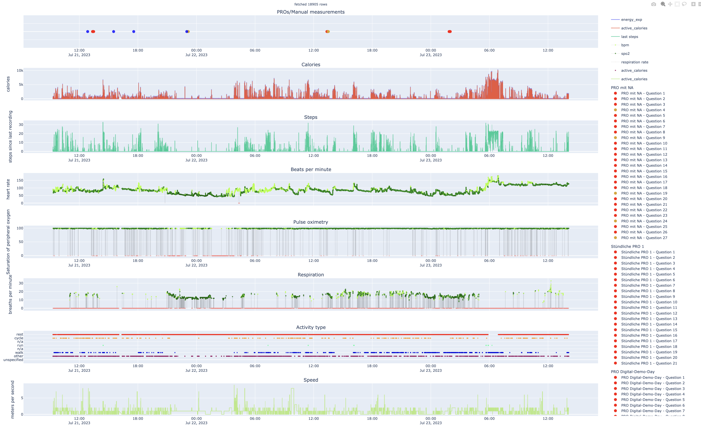
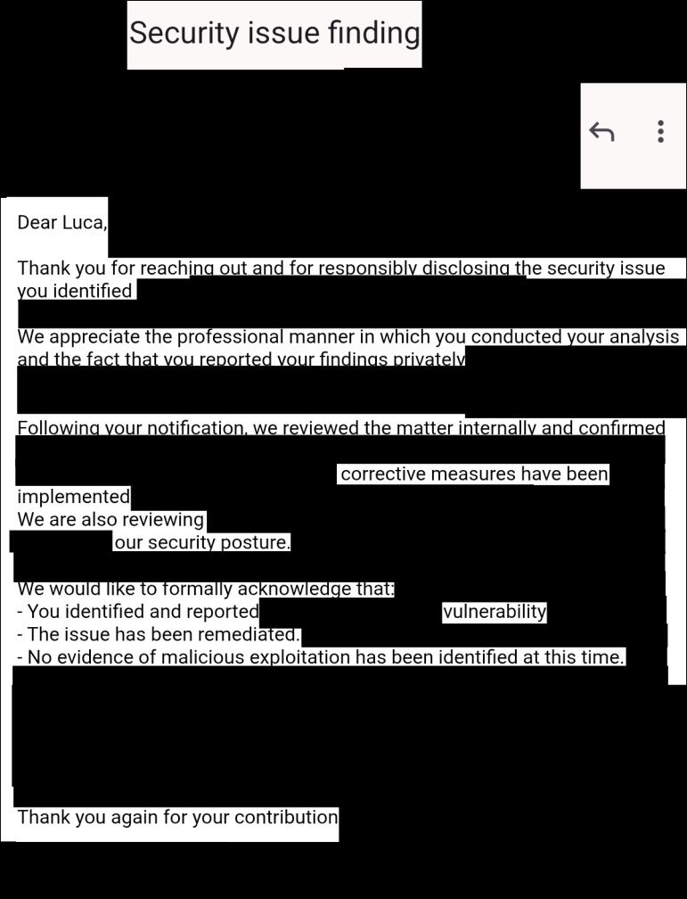

<!--
iframe to https://quoteme.github.io/top2manWebsiteBackground/ with full width
and 300px height
-->
::: {#gimmick .column-screen}
::: {.lang-switch}
[English](/) · Deutsch
:::

::: {#aboutme}

Hallo, ich bin __M.Sc. B.Sc. B.Sc. Luca Leon Happel__, __Mathematiker__, __Informatiker__ und
__Sicherheitsforscher__ aus Düsseldorf.
Mein Team und ich entwickeln, auditieren und hacken Hochsicherheitssysteme und
regulierte Branchen, in denen Fehler teuer sind. Wir machen: __Data Science, KI,
Hochsicherheits-Audits, Reverse Engineering und App-Entwicklung__. Wir arbeiten deutschland-
und europaweit remote und vor Ort.
:::

::: {.cta-row}
<a href="/de/shop/#services" class="btn btn-primary btn-lg"><i class="bi bi-shop"></i> Shop</a>
<a href="/blog.html" class="btn btn-primary btn-lg"><i class="bi bi-journal-text"></i> Mein Blog</a>
:::

<iframe id="top2manframe" src="" style="border: none;"></iframe>
:::

::: {.storefront .column-screen}

::: {.proof-strip}
::: {.proof-item}
**Publiziert** im *European Heart Journal – Digital Health*
:::
::: {.proof-item}
**2× 1. Platz** HHU-Ideenwettbewerb · Festival-Award
:::
::: {.proof-item}
**Kritische Schwachstelle** gefunden und verantwortungsvoll gemeldet
:::
::: {.proof-item}
**MDR-konforme** Medizinsoftware seit 2022
:::
:::

## Für wen ich arbeite {#industries}

::: {.grid .service-grid}
::: {.g-col-12 .g-col-md-4 .service-card}
###  Kliniken & Universitätskliniken
Klinische KI und Data Science auf Patientendaten, DSGVO-konforme
On-Premises-LLMs und RAG, Sicherheitsprüfungen klinischer IT.
:::
::: {.g-col-12 .g-col-md-4 .service-card}
###  Medizinproduktehersteller
MDR-konforme Medizinsoftware, Cybersecurity-Audits und Reverse Engineering von
Geräte-Firmware, Apps und Protokollen.
:::
::: {.g-col-12 .g-col-md-4 .service-card}
###  Kritische Infrastruktur & Industrie
Penetrationstests und Schwachstellenforschung für KRITIS-Betreiber und
Industriesoftware (NIS2, IEC 62443), mit verantwortungsvoller Meldung.
:::
:::

## Referenzen {#work}

::: {.grid .record-grid}

::: {.g-col-12 .g-col-md-6 .record-card}

::: {.eyebrow}
Begutachtete Publikation · August 2025
:::

### monti – KI-Patientenmonitoring

*KI-gestütztes klinisches Monitoring mit modernem ML auf hochsensiblen Patientendaten*

Am Universitätsklinikum Düsseldorf entwickelte KI-Monitoring-Plattform, die
mit modernen KI-Methoden auf hochsensiblen klinischen Patientendaten
Komplikationen bei Herz- und Onkologiepatienten erkennt.

::: {.record-links}
 [10.1093/ehjdh/ztaf004](https://doi.org/10.1093/ehjdh/ztaf004) 
 [Beispieldaten](https://happel.ai/digital-demo-day/assets/activity.html) 
**European Heart Journal – Digital Health**
:::

::: {.tags}
[Journal]{} [KI]{} [klinisches Monitoring]{}
:::
:::

::: {.g-col-12 .g-col-md-6 .record-card}

::: {.eyebrow}
Responsible Disclosure · März 2026
:::

### Schwerwiegende Sicherheitslücke behoben

*Software für kritische Infrastruktur*

Unabhängiges Sicherheitsaudit einer geschäftskritischen Software-Suite, die in
streng regulierten Umgebungen mit höchsten Sicherheitsanforderungen eingesetzt
wird. Dabei wurde eine schwerwiegende Schwachstelle identifiziert, die unter
bestimmten Bedingungen ein Risiko für die physische Sicherheit, die öffentliche
Sicherheit und hohe finanzielle Verluste darstellte. Der Fund wurde
verantwortungsvoll gemeldet und vom Hersteller formell bestätigt.
Korrekturmaßnahmen wurden umgesetzt, um das Ökosystem abzusichern.

::: {.tags}
[Sicherheitsforschung]{} [Responsible Disclosure]{} [Reverse Engineering]{}
:::
:::

:::

:::
