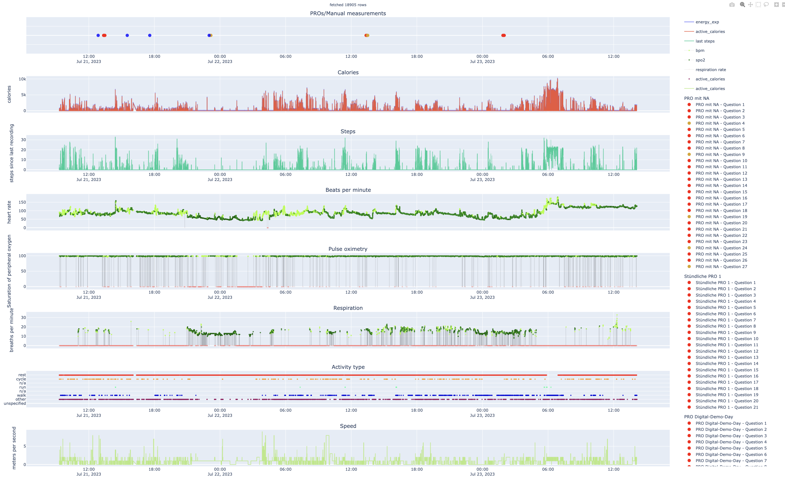
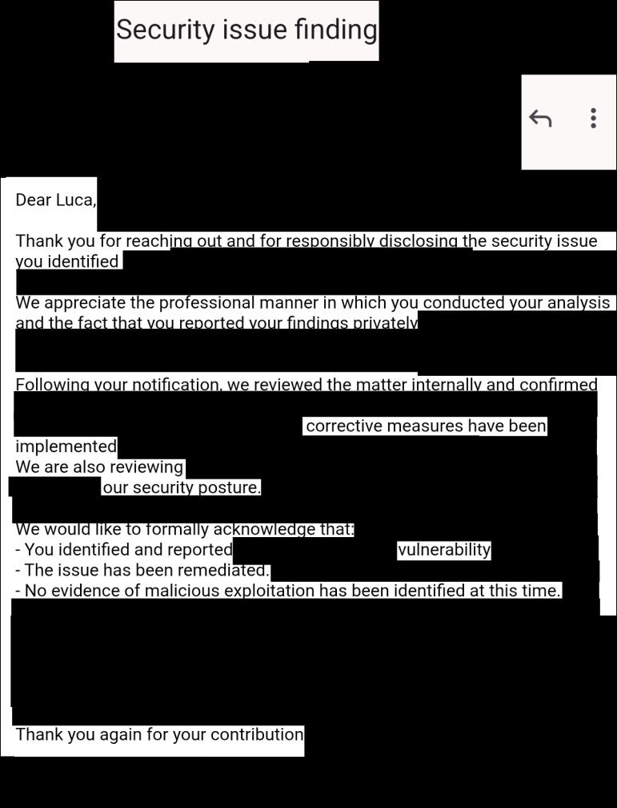

<!--
iframe to https://quoteme.github.io/top2manWebsiteBackground/ with full width
and 300px height
-->
::: {#gimmick .column-screen}
::: {.lang-switch}
English · [Deutsch](/de/)
:::

::: {#aboutme}

Hi, I am __M.Sc. B.Sc. B.Sc. Luca Leon Happel__, a __mathematician__, __computer scientist__ and
__security researcher__ based in Düsseldorf, Germany.
My team and I build, audit and hack high-security systems and regulated industries,
where mistakes are expensive. We do: __data science, AI, high-security audits, reverse
engineering and app development__. We work remotely and on-site across Germany and Europe.
:::

::: {.cta-row}
<a href="/shop/#services" class="btn btn-primary btn-lg"><i class="bi bi-shop"></i> Shop</a>
<a href="/blog.html" class="btn btn-primary btn-lg"><i class="bi bi-journal-text"></i> My blog</a>
:::

<iframe id="top2manframe" src="" style="border: none;"></iframe>
:::

::: {.storefront .column-screen}

::: {.proof-strip}
::: {.proof-item}
**Published** in *European Heart Journal – Digital Health*
:::
::: {.proof-item}
**2× 1st place** HHU Ideenwettbewerb · Festival award
:::
::: {.proof-item}
**Critical vulnerability** found and responsibly disclosed
:::
::: {.proof-item}
**MDR-compliant** medical software since 2022
:::
:::

## Who I work with {#industries}

::: {.grid .service-grid}
::: {.g-col-12 .g-col-md-4 .service-card}
###  Hospitals & university clinics
Clinical AI and data science on patient data, GDPR-compliant on-premises LLMs
and RAG, security reviews of clinical IT.
:::
::: {.g-col-12 .g-col-md-4 .service-card}
###  Medical-device makers
MDR-compliant medical software, cybersecurity audits and reverse engineering of
device firmware, apps and protocols.
:::
::: {.g-col-12 .g-col-md-4 .service-card}
###  Critical infrastructure & industry
Penetration testing and vulnerability research for KRITIS operators and
industrial software (NIS2, IEC 62443), with responsible disclosure.
:::
:::

## Track record {#work}

::: {.grid .record-grid}

::: {.g-col-12 .g-col-md-6 .record-card}

::: {.eyebrow}
Peer-reviewed publication · August 2025
:::

### monti – AI for Patient Monitoring

*AI-based clinical monitoring with advanced ML on high-security patient data*

AI-based monitoring platform developed at University Hospital Düsseldorf,
using advanced AI methods on high-security clinical patient data to detect
complications in heart and oncology patients.

::: {.record-links}
 [10.1093/ehjdh/ztaf004](https://doi.org/10.1093/ehjdh/ztaf004) 
 [Example data](https://happel.ai/digital-demo-day/assets/activity.html) 
**European Heart Journal – Digital Health**
:::

::: {.tags}
[journal]{} [AI]{} [clinical monitoring]{}
:::
:::

::: {.g-col-12 .g-col-md-6 .record-card}

::: {.eyebrow}
Responsible disclosure · March 2026
:::

### High-Severity Security Remediation

*Critical infrastructure software*

Independent security audit of a mission-critical software suite used in highly
regulated and highest-tier security environments. Identified a high-severity
vulnerability that, under some conditions, posed a risk to physical safety,
public security and high monetary losses. The finding was responsibly disclosed
and formally acknowledged by the vendor. Corrective measures have been
implemented to secure the ecosystem.

::: {.tags}
[security research]{} [responsible disclosure]{} [reverse engineering]{}
:::
:::

:::

:::
