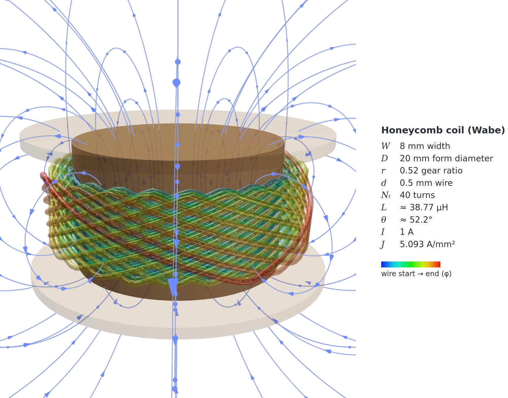

I just created a new project. You can check it out here:
[https://happel.ai/basket-winding/](https://happel.ai/basket-winding/)

You can also play around with the interactive visualization directly here:

<iframe
  src="https://happel.ai/basket-winding/viz/dist/"
  title="Interactive basket-winding visualization"
  width="100%"
  height="600"
  style="border: none;"
  loading="lazy"
  allowfullscreen
></iframe>

This project stems from Daniel Jacobi, a close friend of mine, who has a deep
interest in electrical engineering and electromagnetism, with an eye on their
applications. One Saturday morning I awoke to a call from him about a concept
called "basket windings", which, as he explained, is an old technique in these
disciplines that nowadays seems to be rarely spoken about.

Nonetheless, its applications seemed to be of great use to him, and so we set
out to model the different types of basket windings found in the literature:
first to understand them, and second to build them ourselves with the help of
another engineering friend of ours, Robert Smykala.

In this project we explore the theory, modelling and application of basket
windings. We begin by introducing the three different types of basket windings
and model them using group theory and Lie groups
([1 Fundamentals](https://happel.ai/basket-winding/research/01-fundamentals.html)).

Later on, we take a differential-forms point of view to model the
electromagnetic effects as described by Maxwell's equations
([Electrodynamics in differential forms](https://happel.ai/basket-winding/research/01-fundamentals.html#sec-forms)).
