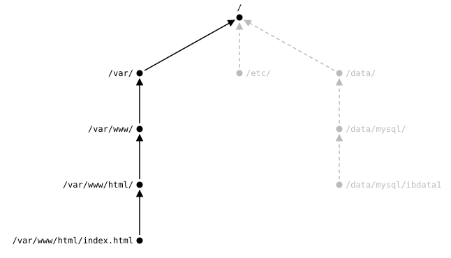
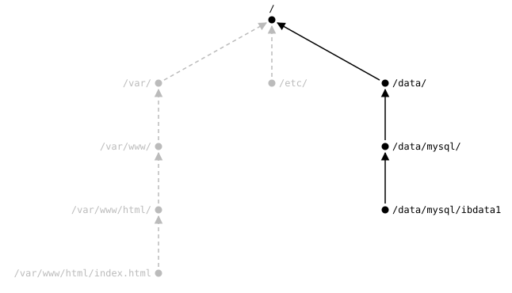

"Linux hardening" is a term sometimes used to mean "increasing the security of
a deployed Linux system". Confusingly enough, it is closely related to _Linux
kernel hardening_, which is encompassed by the aforementioned definition, but
does not exhaust it (so not all of "Linux hardening" is "Linux kernel
hardening" alone!).
One such technique is _mandatory access control_[^arch-mac], as implemented in
SELinux, which was originally developed by the NSA and has since grown into a
large project spanning the kernel and userspace[^selinux-kernel].
We will explore it using the _topos of graphs_, reducing the construction to
just a few lines of formulas by offloading the heavy lifting to topos theory.

[^arch-mac]: See the ArchWiki on
  [mandatory access control](https://wiki.archlinux.org/title/Security#Mandatory_access_control).
[^selinux-kernel]: See the
  [SELinux kernel repository](https://github.com/SELinuxProject/selinux-kernel).

## Mandatory access control

Various techniques exist to implement mandatory access control, such as
AppArmor by Canonical or SELinux, based on work by the NSA. In each case, we
wish to restrict access to files and directories to only certain
users, roles, processes, and so on.
While AppArmor more or less resolves the _pathname_ of such a file or directory
and matches it against a rulebook for each user, role or process to decide
whether access is permitted, SELinux instead stores this access control
information alongside each file or directory as dedicated metadata (a
_security label_, kept in the file's extended attributes).
We will focus on this second approach in this post.

On Linux, each file or directory can naively be seen as a path inside a file
tree: we start with the root `/`, and we can add files to it (`/file`) or
directories (`/directory/`), where each directory can again contain files and
directories, in an _inductive_ fashion. This naturally leads to the depiction
of a file system as a tree, as commonly shown for the Filesystem Hierarchy
Standard (FHS):

```{mermaid}
%%| fig-cap: "A part of the standard FHS of a Linux system."
%%{init: {"theme": "base", "themeVariables": {"background": "#ffffff", "primaryColor": "#ffffff", "primaryBorderColor": "#000000", "primaryTextColor": "#000000", "lineColor": "#000000", "textColor": "#000000", "edgeLabelBackground": "#ffffff", "fontFamily": "sans-serif"}}}%%
flowchart TD
    root["/"] --> bin["/bin/"]
    root --> etc["/etc/"]
    root --> home["/home/"]
    root --> usr["/usr/"]
    root --> var["/var/"]
    etc --> passwd["/etc/passwd"]
    etc --> shadow["/etc/shadow"]
    home --> user["/home/user/"]
    usr --> usrbin["/usr/bin/"]
    usr --> usrlib["/usr/lib/"]
    var --> log["/var/log/"]
```

However, through the use of symbolic links (symlinks), we actually get the
structure of a _graph_ instead of a tree: a file or directory may then be
reachable along several paths, and cycles become possible.
It is therefore easier to start right away by considering a directed graph $X$
for the file system.
Nodes $x$ and $y$ may then be seen as files or directories, and whenever an
edge $p : x \to y$ exists, we consider $y$ to be the parent directory of $x$.
Two observations are immediate:

1. By adding identities and composing edges into paths, $X$ generates a
   category (the _free category_ on $X$), in which a morphism $x \to y$ is a
   path from $x$ up to its ancestor $y$.
2. Every file has empty fan-in, i.e. no inbound arrows, since nothing can be
   placed inside a file. The converse does not hold: an empty directory has
   empty fan-in as well.

An example of such a graph can be seen when we consider a directory `cwd/`,
together with a directory `cwd/sub/`, files `cwd/file1` and `cwd/sub/file2`,
and a symlink `cwd/sub/par/` pointing back to `cwd/`.
The symlink `par` is itself a node with parent `cwd/sub/`, and since it points
to `cwd/`, we add an edge from `cwd` into `par`. This gives the cycle
$\texttt{cwd} \to \texttt{par} \to \texttt{sub} \to \texttt{cwd}$, which cannot
be expressed as a tree anymore.

```{mermaid}
%%| fig-cap: "The file system graph of `cwd/`. Edges point from a file or directory to its parent; the dashed edge points from `cwd/` into the symlink `cwd/sub/par/`."
%%{init: {"theme": "base", "themeVariables": {"background": "#ffffff", "primaryColor": "#ffffff", "primaryBorderColor": "#000000", "primaryTextColor": "#000000", "lineColor": "#000000", "textColor": "#000000", "edgeLabelBackground": "#ffffff", "fontFamily": "sans-serif"}}}%%
flowchart BT
    file1["cwd/file1"] --> cwd["cwd/"]
    sub["cwd/sub/"] --> cwd
    file2["cwd/sub/file2"] --> sub
    par["cwd/sub/par/"] --> sub
    cwd -.-> par
```

<!-- TODO: continue — labels on the nodes of this tree, allow rules between
     labels; small SELinux example policy. -->

## Sheaves over graphs

As we have previously seen, sheaves are the most natural data structure to
track data that is associated to some location. We have used this, for example,
to store state for the game Minecraft per chunk in _Sheaves in
Minecraft_[^sheaves-minecraft] or _Mathcraft: Topoi in Minecraft_[^mathcraft].
Storing access control information per node using sheaves therefore does not
seem that far-fetched.

[^sheaves-minecraft]: See [Sheaves in Minecraft](../sheaves_in_minecraft/).
[^mathcraft]: See [Mathcraft: Topoi in Minecraft](../mathcraft/).

:::{.callout-note collapse="true"}
## The topos of graphs

Funnily enough, graphs themselves can be regarded as presheaves over a certain
small category[^vigna]. This section is taken from my bachelor
thesis[^bachelor].
Let $\Gamma$ be the category with two objects $N$ and $A$ and, besides the
identities, exactly two morphisms
$$N \overset{s}{\underset{t}{\rightrightarrows}} A.$$
The _topos of graphs_ is the presheaf category
$\mathcal{G} = [\Gamma^{\text{op}}, \textbf{Set}]$.

An object $G \in \mathcal{G}$ is uniquely determined by $G(N)$, the set of
nodes, $G(A)$, the set of arcs, and two functions
$G(s), G(t) : G(A) \to G(N)$, which map an arc to its source and target node,
respectively. In other words, $G$ is a directed graph with nodes $G(N)$ and
arcs $G(A)$.

A morphism $f : G \to H$ in $\mathcal{G}$ is a natural transformation between
the presheaves $G$ and $H$, or explicitly a pair of functions
$$f_N : G(N) \to H(N), \qquad f_A : G(A) \to H(A)$$
such that the following diagrams commute:
$$
\begin{array}{ccc}
G(A) & \xrightarrow{G(s)} & G(N) \\
{\scriptstyle f_A} \big\downarrow & & \big\downarrow {\scriptstyle f_N} \\
H(A) & \xrightarrow[H(s)]{} & H(N)
\end{array}
\qquad \text{and} \qquad
\begin{array}{ccc}
G(A) & \xrightarrow{G(t)} & G(N) \\
{\scriptstyle f_A} \big\downarrow & & \big\downarrow {\scriptstyle f_N} \\
H(A) & \xrightarrow[H(t)]{} & H(N)
\end{array}
$$
Intuitively, this means that $f$ maps nodes to nodes and preserves arcs, which
is exactly the standard definition of a graph homomorphism in graph theory.
:::

[^vigna]: Sebastiano Vigna,
  [_A guided tour in the topos of graphs_](https://arxiv.org/abs/math/0306394),
  2003.
[^bachelor]: See my bachelor thesis at
  [happel.ai/bachelor2](https://happel.ai/bachelor2).

Let us now assume that we are given some graph $X \in [\Gamma^{\text{op}},
\textbf{Set}]$, which, as noticed before, we can take to be a category (namely
the free category on $X$).
We can now consider the presheaf category over $X$, given by
$[X^{\text{op}}, \textbf{Set}]$, and take $Y$ to be one of its presheaves,
which assigns to each node the set $\texttt{Bool}$, i.e.
$Y(x) = \texttt{Bool} = \{\bot, \top\}$ for every node $x$.
Each edge $p : x \to y$ is then sent to a restriction map
$Y(p) : Y(y) \to Y(x)$, i.e. a function $\texttt{Bool} \to \texttt{Bool}$ from
the parent directory to its child.

A global element $s : 1 \to Y$ of this presheaf is then given by concretely
associating a compatible choice of boolean values $s_x \in Y(x)$ to each node
$x$ in the graph, where _compatible_ means that $s_x = Y(p)(s_y)$ for every
edge $p : x \to y$.
We can think of $s$ as answering the question "does the user have access to
node $x$?" for every node at once.
As the restriction maps are already a part of $Y$, choosing a value
$s_y \in Y(y)$ for a directory $y$ already determines the access rights of
everything below it, since $s_x = Y(p)(s_y)$ for each edge $p : x \to y$.
Read the other way around, as long as every restriction map sends $\bot$ to
$\bot$ (as is the case in @fig-global-section), $s_x = \top$ forces
$s_y = \top$, so choosing a value for $x$ determines the access rights of all
its parents (i.e. the directories above it).
This is however to be expected, as we might like for a directory to have
access rights, given that at least one of its files is accessible!
This leads us to the notion of _refinement types_, which we will consider for
the topos of graphs in a later post some day.

{#fig-global-section}

## Subgraphs for access control

A possibly even better approach is to consider subgraphs
$Y \rightarrowtail X$. In particular, we only keep those nodes of $X$ in $Y$
which we want the user, role, etc. to have access to (together with the edges
between them).
This is an even more idiomatic approach, as we thereby completely hide all
information about the nodes $x$ of $X$ which are not in $Y$.

{#fig-subgraph}

For this, we need to consider the subobject classifier $\Omega$ of the topos of
graphs[^vigna-omega], which is given by

```{=html}
<figure id="fig-omega" class="figure">
<svg xmlns="http://www.w3.org/2000/svg" viewBox="80 38 300 160" width="340"
     style="display:block;margin:0 auto;color:inherit"
     font-family="'Latin Modern Math','STIX Two Math','Cambria Math',serif" font-size="17">
  <defs>
    <marker id="omega-arr" viewBox="0 0 10 10" refX="9" refY="5" markerWidth="6" markerHeight="6" orient="auto-start-reverse">
      <path d="M0,1 L10,5 L0,9" fill="none" stroke="currentColor" stroke-width="1.5"/>
    </marker>
  </defs>
  <g fill="none" stroke="currentColor" stroke-width="1.1" marker-end="url(#omega-arr)">
    <path d="M 204,113 Q 258,96 313,113"/>
    <path d="M 313,131 Q 258,148 204,131"/>
    <path d="M 168,113 C 132,96 132,148 168,131"/>
    <path d="M 323,108 C 302,68 354,68 333,108"/>
    <path d="M 333,135 C 354,175 302,175 323,135"/>
  </g>
  <g fill="currentColor" stroke="none">
    <text x="186" y="128" text-anchor="middle">0<tspan font-style="italic" font-size="12" dy="4">N</tspan></text>
    <text x="328" y="128" text-anchor="middle" font-style="italic">N</text>
    <text x="114" y="128" text-anchor="middle">0<tspan font-style="italic" font-size="12" dy="4">A</tspan></text>
    <text x="258" y="96" text-anchor="middle" font-style="italic" font-size="15">t</text>
    <text x="258" y="160" text-anchor="middle" font-style="italic" font-size="15">s</text>
    <text x="328" y="186" text-anchor="middle" font-style="italic" font-size="15">A</text>
    <text x="319" y="64" text-anchor="middle" font-size="22" transform="matrix(0.8 0 0 1 63.8 0)">(</text>
    <text x="337" y="64" text-anchor="middle" font-size="22" transform="matrix(0.8 0 0 1 67.4 0)">)</text>
    <text x="328" y="55" text-anchor="middle" font-style="italic" font-size="12">s</text>
    <text x="328" y="68" text-anchor="middle" font-style="italic" font-size="12">t</text>
  </g>
</svg>
<figcaption>The subobject classifier Ω of the topos of graphs.</figcaption>
</figure>
```

where the "true" arrow $\top : 1 \to \Omega$ sends the only node and arc of the
terminal graph $1$ to $N$ and $A$, respectively.

Given a subgraph $m : Y \rightarrowtail X$, the classifying map
$\chi_m : X \to \Omega$ works as follows:

- nodes which are not in $Y$ are mapped to $0_N$;
- nodes which are in $Y$ are mapped to $N$;
- if an arc is not in $Y$, we have four possibilities:
  - arcs whose source and target are not in $Y$ are mapped to $0_A$;
  - arcs whose source is in $Y$, but whose target is not, are mapped to $s$;
  - arcs whose target is in $Y$, but whose source is not, are mapped to $t$;
  - arcs having both source and target in $Y$ are mapped to
    $\binom{s}{t}$;
- finally, an arc in $Y$ is mapped to $A$.

Conversely, $Y$ is recovered from $\chi_m$ as the pullback of $\top$ along
$\chi_m$, and this sets up a one-to-one correspondence between subgraphs of
$X$ and graph morphisms $X \to \Omega$.

In fact, by considering the subobject classifier, it becomes clear that some
other subobjects, which we have not yet considered, are also possible, like
just removing an edge $p : x \to y$ while keeping both $x$ and $y$ (i.e.
mapping $p$ to $\binom{s}{t}$).
This corresponds to keeping the directory $y$, but hiding that $x$ lies inside
it, so that a user without the corresponding access permission cannot follow
through $y$ to $x$.
If $p$ was the only inbound arrow of $y$, then $y$ even appears as an empty
directory to that user.
The node $x$ itself stays accessible, though, possibly along some other path.
For example, removing the edge from `cwd/` into the symlink `cwd/sub/par/`
keeps both `cwd/` and `cwd/sub/par/` visible, but the symlink can no longer be
followed back to `cwd/`.

[^vigna-omega]: See again Vigna,
  [_A guided tour in the topos of graphs_](https://arxiv.org/abs/math/0306394).

Assume now that the graph $X$ is given. How can we encode the access controls
for its users?
We first consider a single user $u$, in which case we can simply store the
characteristic map $\chi_{Y_u} : X \to \Omega$ of the associated subgraph
$Y_u \rightarrowtail X$, after serialization: one of the two nodes of $\Omega$
for every node of $X$, and one of the five arcs of $\Omega$ for every arc of
$X$.

In fact, for multiple users $u_1, \dots, u_k$ we can proceed similarly, by
considering the coproduct of the subgraphs
$$Y_{u_1} \sqcup \dots \sqcup Y_{u_k} \rightarrowtail
X \sqcup \dots \sqcup X,$$
which is again a subgraph (coproducts of monomorphisms are monomorphisms in a
topos). Its characteristic map is the copairing
$$[\chi_{Y_{u_1}}, \dots, \chi_{Y_{u_k}}] : X \sqcup \dots \sqcup X \to \Omega,$$
which we can serialize again.
By the universal properties of the coproduct and the product, this is the same
as a single graph morphism
$$\langle \chi_{Y_{u_1}}, \dots, \chi_{Y_{u_k}} \rangle :
X \to \Omega \times \dots \times \Omega,$$
which stores at every node and arc of $X$ a $k$-tuple of access rights, one
per user. This is precisely the SELinux approach from the beginning: the access
control information is kept alongside each file or directory.

## Example: Apache and MariaDB

As Immanuel Kant said in his _Critique of Pure Reason_[^kant],

> Gedanken ohne Inhalt sind leer, Anschauungen ohne Begriffe sind blind

(thoughts without content are empty, intuitions without concepts are blind).
We therefore wish to put the abstract theory of this post to work on the go-to
example of SELinux, as described in Red Hat's official guide[^redhat]:
assume we have two processes, an Apache web server running in the SELinux
domain `httpd_t`, and a MariaDB database server running in the domain
`mysqld_t`.
We want to grant `httpd_t` access to the web content in `/var/www/html/`
(labeled `httpd_sys_content_t`), and `mysqld_t` access to the database files in
`/data/mysql/` (labeled `mysqld_db_t`), but not give `httpd_t` access to
`/data/mysql/`, and vice versa not give `mysqld_t` access to `/var/www/html/`!
This is depicted in the following diagram:

```{mermaid}
%%| fig-cap: "Apache and MariaDB confined by SELinux, after Red Hat's guide. Solid arrows are allowed accesses, dashed arrows are denied ones."
%%{init: {"theme": "base", "themeVariables": {"background": "#ffffff", "primaryColor": "#ffffff", "primaryBorderColor": "#000000", "primaryTextColor": "#000000", "lineColor": "#000000", "textColor": "#000000", "edgeLabelBackground": "#ffffff", "fontFamily": "sans-serif"}}}%%
flowchart TB
    apache["Apache<br/><code>httpd_t</code>"] --> www["/var/www/html/<br/><code>httpd_sys_content_t</code>"]
    mariadb["MariaDB<br/><code>mysqld_t</code>"] --> mysql["/data/mysql/<br/><code>mysqld_db_t</code>"]
    apache -. "✗" .-> mysql
    mariadb -. "✗" .-> www
```

We therefore need two different subgraphs of (a small part of) the FHS: one
for `httpd_t` and one for `mysqld_t`, as we can see here:

::: {#fig-apache-mariadb layout-ncol=2}

{#fig-fhs-httpd}

{#fig-fhs-mysqld}

The subgraphs of the FHS (bottom) that Apache and MariaDB have access to (top).
:::

These two subgraphs are now given by the following two characteristic maps
$\chi_{\texttt{httpd\_t}}, \chi_{\texttt{mysqld\_t}} : \text{FHS} \to \Omega$.
On nodes, they are given by
$$
\chi_{\texttt{httpd\_t}}(x) = \begin{cases}
  N & x \in \{\texttt{/}, \texttt{/var/}, \texttt{/var/www/},
      \texttt{/var/www/html/}, \texttt{/var/www/html/index.html}\} \\
  0_N & \text{otherwise}
\end{cases}
$$
$$
\chi_{\texttt{mysqld\_t}}(x) = \begin{cases}
  N & x \in \{\texttt{/}, \texttt{/data/}, \texttt{/data/mysql/},
      \texttt{/data/mysql/ibdata1}\} \\
  0_N & \text{otherwise}
\end{cases}
$$
and on arcs $p : x \to y$ by
$$
\chi_{\texttt{httpd\_t}}(p) = \begin{cases}
  A & x \in \{\texttt{/var/}, \texttt{/var/www/}, \texttt{/var/www/html/},
      \texttt{/var/www/html/index.html}\} \\
  t & x \in \{\texttt{/etc/}, \texttt{/data/}\} \\
  0_A & \text{otherwise}
\end{cases}
$$
$$
\chi_{\texttt{mysqld\_t}}(p) = \begin{cases}
  A & x \in \{\texttt{/data/}, \texttt{/data/mysql/},
      \texttt{/data/mysql/ibdata1}\} \\
  t & x \in \{\texttt{/etc/}, \texttt{/var/}\} \\
  0_A & \text{otherwise}
\end{cases}
$$
(every node except `/` has exactly one outgoing arc, to its parent directory,
so it suffices to name the source $x$ of $p$).
For example, the arc from `/data/` to `/` is sent to $t$ by
$\chi_{\texttt{httpd\_t}}$: Apache may see `/`, but not that `/data/` lies
inside it.

Finally, by considering the coproduct, we have a map from the algebraic data
type[^adt] $\text{FHS} \sqcup \text{FHS}$ (think `Either FHS FHS` in Haskell)
to $\Omega$, namely the copairing
$$[\chi_{\texttt{httpd\_t}}, \chi_{\texttt{mysqld\_t}}] :
\text{FHS} \sqcup \text{FHS} \to \Omega,$$
i.e. using the universal properties of the coproduct and the product, a single
graph morphism
$$\langle \chi_{\texttt{httpd\_t}}, \chi_{\texttt{mysqld\_t}} \rangle :
\text{FHS} \to \Omega \times \Omega,$$
where the projection onto the first $\Omega$ in the product corresponds to the
access control given to the Apache process running in the domain `httpd_t`,
and the projection onto the second $\Omega$ to the access control given to the
MariaDB process running in the domain `mysqld_t`.
Storing this morphism node by node and arc by arc is exactly storing a label
alongside each file and directory, as SELinux does.

[^kant]: Immanuel Kant, _Kritik der reinen Vernunft_, A51/B75.
[^redhat]: See Red Hat,
  [_Using SELinux_, Chapter 1: Getting started with SELinux](https://docs.redhat.com/en/documentation/red_hat_enterprise_linux/8/html/using_selinux/getting-started-with-selinux_using-selinux).
[^adt]: See the Haskell wiki on
  [algebraic data types](https://wiki.haskell.org/Algebraic_data_type).

## Serialization

We can now finally serialize this map and store it to disk, by encoding these
characteristic maps and storing the tuples.
Remember that a graph is a presheaf $X$ over $N \rightrightarrows A$, and that
a graph morphism $\chi : X \to \Omega$ is a natural transformation, i.e. a pair
of functions
$$\chi_N : X(N) \to \Omega(N), \qquad \chi_A : X(A) \to \Omega(A).$$
Therefore, we need to store

- for each node $v \in X(N)$ the value
  $\chi_N(v) \in \Omega(N) = \{0_N, N\} \cong \texttt{Bool}$, i.e. a single
  bit, and
- for each arc $p \in X(A)$ the value
  $\chi_A(p) \in \Omega(A) = \{0_A, s, t, \tbinom{s}{t}, A\}$, one of five
  values.

Naturality saves us most of the second part, though: the source and target of
$\chi_A(p)$ have to be $\chi_N$ of the source and target of $p$.
If one of the two endpoints of $p$ is sent to $0_N$, this already determines
$\chi_A(p)$ uniquely (as $0_A$, $s$ or $t$), so nothing needs to be stored.
Only if both endpoints are sent to $N$ do we have to store one more bit,
deciding between $A$ (the arc is visible) and $\binom{s}{t}$ (the arc is
hidden).
For the Apache example, this means one bit per node, and one bit for each of
the four arcs between visible nodes.

For $k$ processes, the morphism
$\langle \chi_1, \dots, \chi_k \rangle : X \to \Omega^k$ is stored in the same
way, as a $k$-tuple of such values at every node and every arc.
On a real file system, the values at a node can be kept in the extended
attributes of the corresponding file or directory, just like the
`security.selinux` attribute in which SELinux stores its labels, and the values
at an arc $p : x \to y$ alongside the directory entry of $x$ in $y$.

By these observations, we can conclude that each file, directory and symlink
needs an additional bit per user (or rather, per SELinux domain), encoding
whether it should be accessible to that user.
For directories and symlinks in particular, we also need to store a bit for
each of their links (i.e. each entry of a directory, or the target of a
symlink) for each user, signifying whether that link should also be accessible
to the user.
In our graph, these links are precisely the inbound arcs of the node, as arcs
point from a file to its parent directory.
Following the observation above, this bit only matters when both ends of the
link are accessible; otherwise we simply store `false`.
This gives us:

{#fig-fhs-labels}
