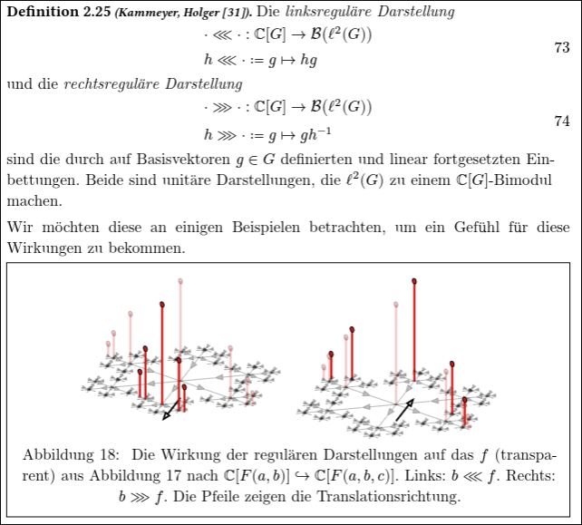

I am currently writing my masters thesis about the connection between a
generalization of the reidemeister-torsion (called $\ell^2$-alexander torsion)
and the [thurston norm](https://en.wikipedia.org/wiki/Thurston_norm) of
3-manifolds.

Check it out, if you like:

<iframe
  src="/masterarbeit"
  style="width:100%; height:600px; border:none;"
  title="Masterarbeit PDF"></iframe>

[Masterarbeit.pdf](/masterarbeit)

Some pictures of it can be found here:
<https://www.instagram.com/stories/highlights/18097883624515441/>

## How To Read This Thesis

In contrast to traditional thesis, I have extensively used hyperlinks to make 
it easier to read. Specifically section 4 (the main part of the thesis) relies
heavily on the results of section 1 to 3.

While I do recommend reading the thesis in order, once you get to section 4,
please use the hyperlinks to navigate back and forth between the linked
examples, definitions and theorems.

Especially section 4 is very dense and highly complicated. Nonetheless, I strived
to make it as intuitive as possible. If you do use the hyperlinks, the text
which at first glance seems too dense will unfold itself into more of a
picturebook where proofs become more of a visual story than just a formal argument.

In general I strive to convey the _semantics_ more than just the _syntax_.
During this thesis, this was very hard and juggling mathematical correctness
with intuitive explanations therefore lead to this non-standard format. I am
certain that this kind of format will become the future of how we write and read
mathematical texts though, as hyperlinks and visualizations are a no-brainer for
conveying complicated ideas.

## My Stance On Critique Towards My Thesis

My thesis was criticized by two supervisors.
These boil down to the following points:

1. The visualizations are not rigorous enough (possibly childish)
2. Some examples (like the "physical interpretation") of reidemeister torsion
  and its applications to physics were redundant
3. The notation is non-standard
4. The main part (section 4) is disproportionally short (only 25%) 
  compared to the introductory sections (75%)
5. I had a mistake in definition 2.22 where I stated the absolute 
  reidemeister torsion is independent of the choice of representation

Here are my thoughts on these points:

1. The main ctiricism was that I used 3d renders of a car in a tube which I have
   twisted using blenders geometry nodes to visualize "what life is like" in a 
   seifert manifold:
   
   However, I was inspired by classical textbooks like "William L. Burke, Applied Differential Geometry (Cambridge University Press, 1985).",
   which had this visualization (also including a car):
   
   and also [Conway's classical ZIP proof](https://webhomes.maths.ed.ac.uk/~v1ranick/papers/francisweeks.pdf) of the classification of surfaces,
   which uses pants and zippers to visualize the core ideas from geometry and topology:
   
   I was told my visualizations should have been more technical, like this one
   
   from "Holger Kammeyer, Introduction to Algebraic Topology (Springer International Publishing, 2022)".
2. Regarding the physical interpretation, and general references to
   physics/cosmology, I think that there should be no shame in that. Physics and
   mathematics go hand in hand and I think it is cool to actually find
   applications of pure mathematics in "real like" (aka. physics).
   Also, I was quite proud of my "physical interpretation" of reidemeister torsion,
   as it related the predecessor of $\ell^2$-alexander torsion (reidemeister
   torsion) to electromagnetism. In fact, to see this connection one has to walk a
   fun journey through algebra, geometry, topology and analysis. I also just really
   liked how the geometric series suddenly showed up and related to monopoles and
   answered the question of "what does the reidemeister torsion actually measure?"
   
3. Fair enough, I used $\lll$ and $\rrr$ instead of $\lambda$ and $\rho$ for
   the left and right regular representation. I still think regarding currying that
   this was the right choice. It also more closely aligns with
   how group actions are usually denoted as $a \triangleright x$ for $a \in G$
   and $x \in X$ with $G \curvearrowright X$.
   
4. The main section being short has already been explain in "How To Read This
   Thesis" above.
5. I have fixed the mistake. The reidemeister torsion is only independent of the
   choice of representation _up to equivalent_ representations.
   This was clear in my submitted thesis, but I nontheless made it more explicit
   now. This error feels more like when students forget to say "up to
isomorphism" in their proofs.


## Analyzing My Progress

I reuse some code i have from [my post where I analyze my NixOS GitHub
repository](/posts/nixos-git-analysis/).

```{python}
import os
from datetime import date, datetime
import git

REPO_URL = "https://github.com/quoteme/masterarbeit.git"
REPO_DIR = "/tmp/quoteme-masterarbeit"
CUTOFF_DATE = date(2025, 10, 8)
repo : git.Repo = (
    git.Repo(REPO_DIR)
    if os.path.exists(REPO_DIR)
    else git.Repo.clone_from(REPO_URL, REPO_DIR, bare=True)
)
repo.remotes.origin.fetch("+refs/heads/*:refs/heads/*")
commits = [
  commit
  for commit in repo.iter_commits('--all')
  if commit.committed_datetime.date() >= CUTOFF_DATE
]
if not commits:
  raise ValueError(f"No commits found on or after {CUTOFF_DATE.isoformat()}")
# summary of the total number of commits
print(f"Total commits: {len(commits)}")
print(f"First commit: {datetime.fromtimestamp(commits[-1].committed_date)}")
print(f"Last commit: {datetime.fromtimestamp(commits[0].committed_date)}")
print(f"Avg. time between commits: {(commits[0].committed_date - commits[-1].committed_date) / len(commits) / 3600:.2f} hours")
```

```{python}
import plotly.graph_objects as go

commits_sorted = sorted(commits, key=lambda c: c.committed_datetime)
commit_dates = [c.committed_datetime for c in commits_sorted]
commit_indices = list(range(1, len(commits_sorted) + 1))

fig = go.Figure(
  data=[
    go.Scatter(
      x=commit_dates,
      y=commit_indices,
      mode="markers",
      marker=dict(size=7, color="#4C78A8", opacity=0.85),
      hovertemplate="Date: %{x|%Y-%m-%d %H:%M:%S}<br>Commit #: %{y}<extra></extra>",
      showlegend=False,
    )
  ]
)

fig.update_layout(
  title=f"Commits since {CUTOFF_DATE.isoformat()} · quoteme/masterarbeit",
  xaxis_title="Date",
  yaxis_title="Commit number",
  template="plotly_white",
  height=450,
)

fig.show()
```

```{python}
from collections import Counter
from datetime import timedelta
import numpy as np
import plotly.graph_objects as go

forecast_end_date = date(2026, 4, 6)

daily_counter = Counter(c.committed_datetime.date() for c in commits_sorted)
observed_end_date = max(daily_counter.keys())
observed_dates = [
  CUTOFF_DATE + timedelta(days=i)
  for i in range((observed_end_date - CUTOFF_DATE).days + 1)
]
observed_daily = np.array([daily_counter.get(d, 0) for d in observed_dates], dtype=float)
observed_cumulative = np.cumsum(observed_daily)

t_obs = np.arange(len(observed_dates), dtype=float)
slope, intercept = np.polyfit(t_obs, observed_cumulative, deg=1)

all_dates = [
  CUTOFF_DATE + timedelta(days=i)
  for i in range((forecast_end_date - CUTOFF_DATE).days + 1)
]
t_all = np.arange(len(all_dates), dtype=float)
linear_cumulative = np.clip(slope * t_all + intercept, a_min=0.0, a_max=None)

# Plot 1: linear model forecast
linear_fig = go.Figure()
linear_fig.add_trace(
  go.Scatter(
    x=observed_dates,
    y=observed_cumulative,
    mode="lines+markers",
    name="Observed cumulative",
    marker=dict(size=5),
    line=dict(width=2),
  )
)
linear_fig.add_trace(
  go.Scatter(
    x=all_dates,
    y=linear_cumulative,
    mode="lines",
    name="Linear regression",
    line=dict(width=2, dash="dash"),
  )
)
linear_fig.add_vline(
  x=observed_end_date,
  line_width=1,
  line_dash="dash",
  line_color="gray",
)
linear_fig.update_layout(
  title=f"Linear model extrapolation until {forecast_end_date.isoformat()}",
  xaxis_title="Date",
  yaxis_title="Cumulative commits since cutoff",
  template="plotly_white",
  height=460,
)
linear_fig.show()

expected_linear = float(linear_cumulative[-1])
print(f"Expected cumulative commits by {forecast_end_date.isoformat()} (linear): {expected_linear:.1f}")
```

```{python}
import numpy as np
import plotly.graph_objects as go
try:
  from ripser import ripser
except ImportError as exc:
  raise ImportError("ripser.py is required for TDA analysis. Install with: pip install ripser") from exc

# TDA with ripser.py on Takens embedding of daily commits
embed_dim = 3
if len(observed_daily) >= embed_dim:
  point_cloud = np.array(
    [observed_daily[i:i + embed_dim] for i in range(len(observed_daily) - embed_dim + 1)],
    dtype=float,
  )
else:
  point_cloud = observed_daily.reshape(-1, 1)

dgms = ripser(point_cloud, maxdim=1)["dgms"]
h0 = dgms[0]
h1 = dgms[1] if len(dgms) > 1 else np.empty((0, 2))

def finite_lifetimes(diagram: np.ndarray) -> np.ndarray:
  if diagram.size == 0:
    return np.array([], dtype=float)
  births = diagram[:, 0]
  deaths = diagram[:, 1]
  mask = np.isfinite(deaths)
  if not np.any(mask):
    return np.array([], dtype=float)
  return np.maximum(deaths[mask] - births[mask], 0.0)

lifetimes = np.concatenate([finite_lifetimes(h0), finite_lifetimes(h1)])
if lifetimes.size == 0:
  lifetimes = np.array([1.0], dtype=float)

tda_scale = float(np.median(lifetimes))
tda_scale = max(tda_scale, 1e-6)

# Fit a local state-space model on the embedded points for extrapolation
if len(observed_daily) >= embed_dim + 1:
  X_train = np.array(
    [observed_daily[i:i + embed_dim] for i in range(len(observed_daily) - embed_dim)],
    dtype=float,
  )
  y_train = np.array(
    [observed_daily[i + embed_dim] for i in range(len(observed_daily) - embed_dim)],
    dtype=float,
  )

  simulated_daily = observed_daily.tolist()
  future_days = len(all_dates) - len(observed_dates)

  for _ in range(future_days):
    state = np.array(simulated_daily[-embed_dim:], dtype=float)
    distances = np.linalg.norm(X_train - state, axis=1)
    weights = np.exp(-distances / tda_scale)
    weight_sum = float(weights.sum())
    next_value = (
      float(np.dot(weights, y_train) / weight_sum)
      if weight_sum > 0
      else float(y_train.mean())
    )
    simulated_daily.append(max(next_value, 0.0))

  tda_cumulative = np.cumsum(np.array(simulated_daily, dtype=float))
else:
  tda_cumulative = linear_cumulative.copy()

expected_tda = float(tda_cumulative[-1])

print(f"Expected cumulative commits by {forecast_end_date.isoformat()} (tda/ripser-model): {expected_tda:.1f}")

# Plot 2a: TDA (ripser.py) model forecast
tda_fig = go.Figure()
tda_fig.add_trace(
  go.Scatter(
    x=observed_dates,
    y=observed_cumulative,
    mode="lines+markers",
    name="Observed cumulative",
    marker=dict(size=5),
    line=dict(width=2),
  )
)
tda_fig.add_trace(
  go.Scatter(
    x=all_dates,
    y=tda_cumulative,
    mode="lines",
    name="TDA (ripser.py) model",
    line=dict(width=2, dash="dot"),
  )
)
tda_fig.add_vline(
  x=observed_end_date,
  line_width=1,
  line_dash="dash",
  line_color="gray",
)
tda_fig.update_layout(
  title=f"TDA (ripser.py) extrapolation until {forecast_end_date.isoformat()}",
  xaxis_title="Date",
  yaxis_title="Cumulative commits since cutoff",
  template="plotly_white",
  height=460,
)
tda_fig.show()

# Plot 2b: barcode plot (commit cadence topology)
barcode_fig = go.Figure()

def add_barcode(diagram: np.ndarray, y_offset: float, name: str, color: str) -> float:
  if diagram.size == 0:
    return y_offset
  finite = diagram[np.isfinite(diagram[:, 1])]
  for i, (birth, death) in enumerate(finite):
    y = y_offset + i
    barcode_fig.add_trace(
      go.Scatter(
        x=[birth, death],
        y=[y, y],
        mode="lines",
        line=dict(color=color, width=2),
        name=name if i == 0 else None,
        showlegend=(i == 0),
        hovertemplate=f"{name}<br>birth: %{{x[0]:.4f}}<br>death: %{{x[1]:.4f}}<extra></extra>",
      )
    )
  return y_offset + len(finite) + 2

y0 = 0.0
y0 = add_barcode(h0, y0, "H0 barcode", "#4C78A8")
y0 = add_barcode(h1, y0, "H1 barcode", "#F58518")

if len(barcode_fig.data) == 0:
  barcode_fig.add_annotation(
    text="No finite persistence intervals available",
    xref="paper", yref="paper", x=0.5, y=0.5, showarrow=False
  )

barcode_fig.update_layout(
  title="Ripser barcode plot for commit cadence (Takens embedding)",
  xaxis_title="Filtration value",
  yaxis_title="Barcode index",
  template="plotly_white",
  height=420,
)
barcode_fig.show()
```

```{python}
import numpy as np
import plotly.graph_objects as go

# Fit y(x) = p6(x) + a*sin(x) + b*sin(x)^2 on observed cumulative commits.
x_obs = np.arange(len(observed_dates), dtype=float)
y_obs = observed_cumulative.astype(float)

# Normalize x to improve numerical conditioning for degree-6 polynomial.
x_mean = float(x_obs.mean())
x_std = float(x_obs.std()) if float(x_obs.std()) > 0 else 1.0
z_obs = (x_obs - x_mean) / x_std

poly_design = np.column_stack([z_obs ** k for k in range(7)])
trig_design = np.column_stack([np.sin(z_obs), np.sin(z_obs) ** 2])
design_obs = np.column_stack([poly_design, trig_design])

coeffs, *_ = np.linalg.lstsq(design_obs, y_obs, rcond=None)
y_fit_obs = design_obs @ coeffs

x_all = np.arange(len(all_dates), dtype=float)
z_all = (x_all - x_mean) / x_std
design_all = np.column_stack(
  [np.column_stack([z_all ** k for k in range(7)]), np.sin(z_all), np.sin(z_all) ** 2]
)
y_poly_trig_all = np.clip(design_all @ coeffs, a_min=0.0, a_max=None)

expected_poly_trig = float(y_poly_trig_all[-1])
print(
  f"Expected cumulative commits by {forecast_end_date.isoformat()} "
  f"(poly6 + sin + sin^2): {expected_poly_trig:.1f}"
)

poly_trig_fig = go.Figure()
poly_trig_fig.add_trace(
  go.Scatter(
    x=observed_dates,
    y=y_obs,
    mode="lines+markers",
    name="Observed cumulative",
    marker=dict(size=5),
    line=dict(width=2),
  )
)
poly_trig_fig.add_trace(
  go.Scatter(
    x=observed_dates,
    y=y_fit_obs,
    mode="lines",
    name="Fit on observed",
    line=dict(width=2, dash="dash"),
  )
)
poly_trig_fig.add_trace(
  go.Scatter(
    x=all_dates,
    y=y_poly_trig_all,
    mode="lines",
    name="Poly6 + sin + sin² extrapolation",
    line=dict(width=2, dash="dot"),
  )
)
poly_trig_fig.add_vline(
  x=observed_end_date,
  line_width=1,
  line_dash="dash",
  line_color="gray",
)
poly_trig_fig.update_layout(
  title=f"Polynomial-trigonometric extrapolation until {forecast_end_date.isoformat()}",
  xaxis_title="Date",
  yaxis_title="Cumulative commits since cutoff",
  template="plotly_white",
  height=460,
)
poly_trig_fig.show()
```

# Conclusion

From the commit graph one can clearly see that I have spent the first 3 months 
researching and not writing. Once I got the hang of the topic, I started
writing, spending pretty much every wake hour on it and submitting the thesis on
time.

If I were to do it again, I would however start writing earlier, even while
still doing research, so that in the end I have more time to polish the thesis
and request feedback from my supervisors.
