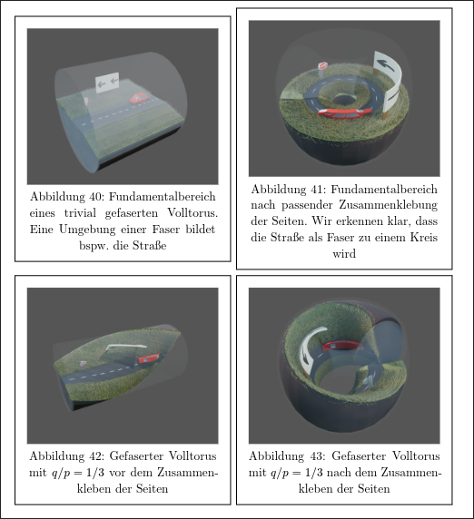
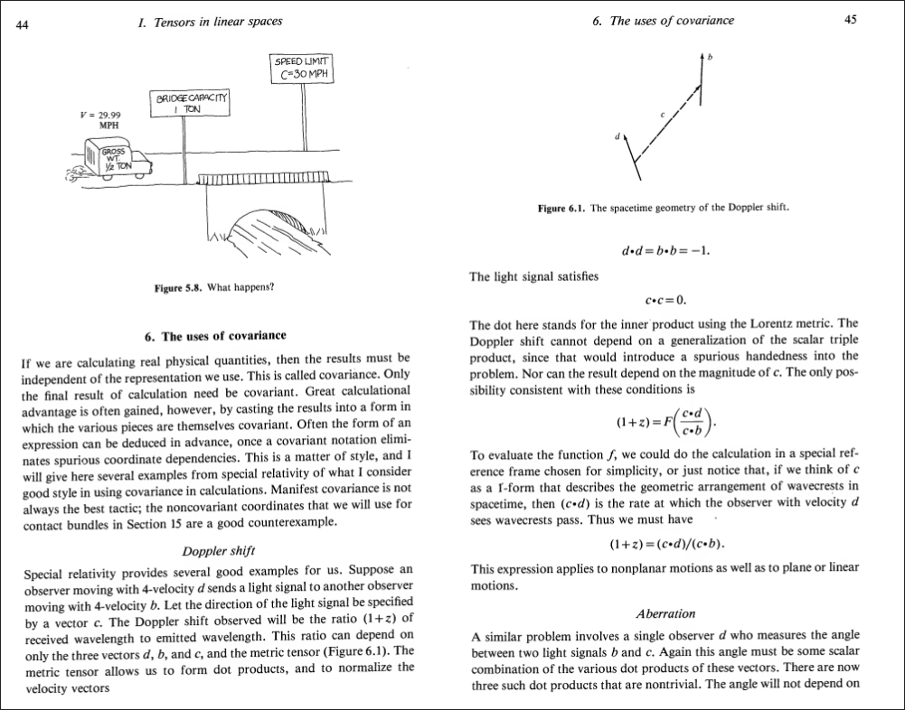
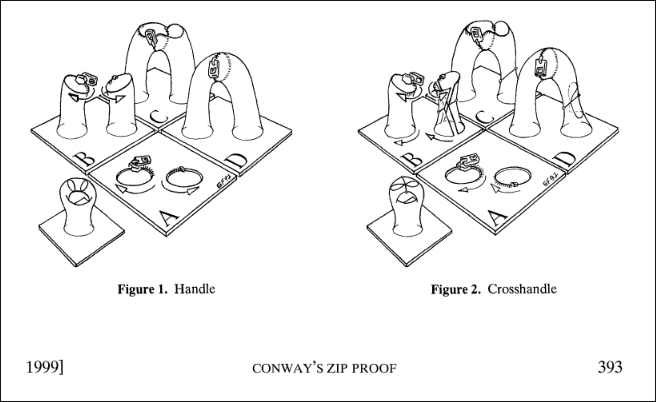
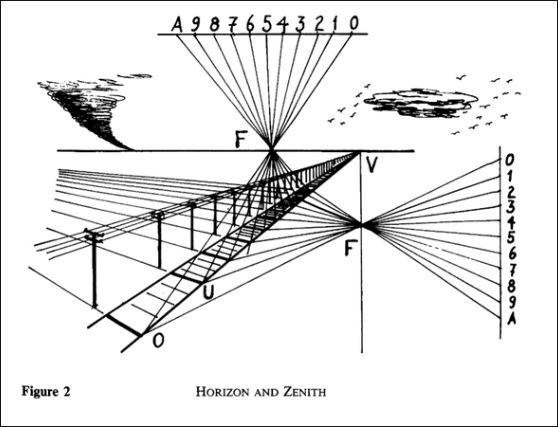
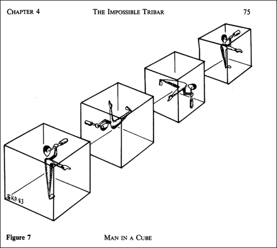
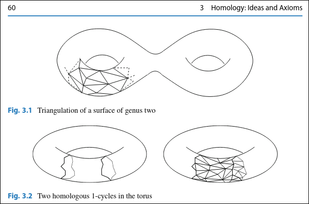
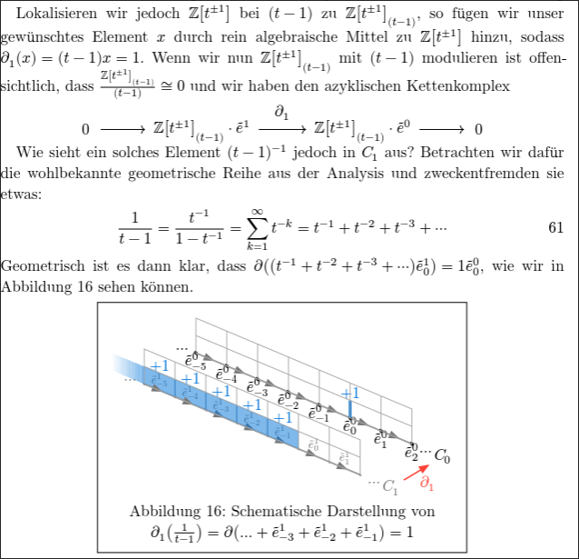
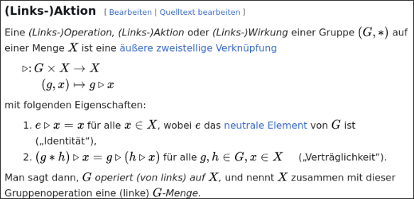

I was writing my masters thesis about the connection between a
generalization of the reidemeister-torsion (called $\ell^2$-alexander torsion)
and the [thurston norm](https://en.wikipedia.org/wiki/Thurston_norm) of
3-manifolds.
Check it out, if you like:

<iframe
  src="/masterarbeit"
  style="width:100%; height:600px; border:none;"
  title="Masterarbeit PDF"
  height="600"
></iframe>

[Masterarbeit.pdf](/masterarbeit)

Some pictures of it can be found [here](https://www.instagram.com/stories/highlights/18097883624515441/).

## How To Read This Thesis

I have used hyperlinks extensively. Especially the main part (section 4) is very
short, as it links to previous results and definitions.
Here is an example of how to read the thesis:
(In dark mode the hyperlinks are highlighted in a light blue color, so they are
easier to spot. In light mode they also work, but they are not highlighted, as
my supervisor wanted)

::: {layout-ncol=3}
{.lightbox group="how-to-read"}

{.lightbox group="how-to-read"}

{.lightbox group="how-to-read"}

{.lightbox group="how-to-read"}

{.lightbox group="how-to-read"}

{.lightbox group="how-to-read"}
:::

In general I strive to convey the _semantics_ more than just the _syntax_.
During this thesis, this was very hard and juggling mathematical correctness
with intuitive explanations. I tried to use a more modern approach an used 
hyperlinks, which might be non-standard. I am
certain that this kind of format will become the future of how we write and read
mathematical texts though, as hyperlinks and visualizations are a no-brainer for
conveying complicated ideas.

## Critique

My thesis was criticized, and the main points of critique boil down to the
following points:

1. The visualizations are not rigorous enough (possibly childish)
2. Some examples (like the "physical interpretation") of reidemeister torsion
  and its applications to physics were redundant
3. The notation is non-standard
4. The main part (section 4) is disproportionally short (only 25%) 
  compared to the introductory sections (75%)
5. I had a mistake in definition 2.22 where I stated the absolute 
  reidemeister torsion is independent of the choice of representation
6. It seemed rushed

Here are my thoughts on these points:

1. The main ctiricism was that I used 3d renders of a car in a tube which I have
   twisted using blenders geometry nodes to visualize "what life is like" in a 
   seifert manifold:

   ::: {layout-ncol=3}
   {.lightbox}
   :::

   However, I was inspired by classical textbooks like
   "William L. Burke, Applied Differential Geometry (Cambridge University Press, 1985).",
   which had this visualization (also including a car):
   and also [Conway's classical ZIP proof](https://webhomes.maths.ed.ac.uk/~v1ranick/papers/francisweeks.pdf) of the classification of surfaces,
   which uses pants and zippers to visualize the core ideas from geometry and topology:

   ::: {layout-ncol=3}
   {.lightbox group="various-visualizations"}

   {.lightbox group="various-visualizations"}

   {.lightbox group="various-visualizations"}

   {.lightbox group="various-visualizations"}

   {.lightbox group="various-visualizations"}
   :::

2. Regarding the physical interpretation, and general references to
   physics/cosmology, I think that there should be no shame in that. Physics and
   mathematics go hand in hand and I think it is cool to actually find
   applications of pure mathematics in "real like" (aka. physics).
   Also, I was quite proud of my "physical interpretation" of reidemeister torsion,
   as it related the predecessor of $\ell^2$-alexander torsion (reidemeister
   torsion) to electromagnetism. In fact, to see this connection one has to walk a
   fun journey through algebra, geometry, topology and analysis. I also just really
   liked how the geometric series suddenly showed up and related to monopoles and
   answered the question of "what does the reidemeister torsion actually measure?"

   ::: {layout-ncol=3}
   
   :::
   
3. Fair enough, I used $\lll$ and $\ggg$ instead of $\lambda$ and $\rho$ for
   the left and right regular representation. I still think regarding currying that
   this was the right choice. It also more closely aligns with
   how group actions are usually denoted as $a \triangleright x$ for $a \in G$
   and $x \in X$ with $G \curvearrowright X$.
   
   ::: {layout-ncol=3}
   {.lightbox group="group-action"}
   {.lightbox group="group-action"}
   :::
4. The main section being short has already been explain in "How To Read This
   Thesis" above.
5. I have indeed stated an incorrect theorem.
   I have fixed that mistake since. The reidemeister torsion is only independent of the
   choice of representation _up to equivalent_ representations.
   This was clear in my submitted thesis, but I nontheless made it more explicit
   now. This error feels more like when students forget to say "up to
   isomorphism" in their proofs.

6. Yes, I did have various grammatical and
   spelling errors. Also, the bibliography (exported using [Zotero](https://www.zotero.org/))
   had mistakes in it, which I did not catch.
   Should have been more careful and proofread it more often.

From this I have learned that I should have asked my supervisor more often for 
feedback, as errors could have been caught earlier.
Regarding the visualizations and examples from physics, I still like them.
Also the modern hyperlink based approach I would not like to change; but it
seems the mathematical community is not ready for it yet.


## Analyzing My Progress

I reuse some code i have from [my post where I analyze my NixOS GitHub
repository](/posts/nixos-git-analysis/).

```{python}
import os
from datetime import date, datetime
import git

REPO_URL = "https://github.com/quoteme/masterarbeit.git"
REPO_DIR = "/tmp/quoteme-masterarbeit"
CUTOFF_DATE = date(2025, 10, 8)
repo : git.Repo = (
    git.Repo(REPO_DIR)
    if os.path.exists(REPO_DIR)
    else git.Repo.clone_from(REPO_URL, REPO_DIR, bare=True)
)
repo.remotes.origin.fetch("+refs/heads/*:refs/heads/*")
commits = [
  commit
  for commit in repo.iter_commits('--all')
  if commit.committed_datetime.date() >= CUTOFF_DATE
]
if not commits:
  raise ValueError(f"No commits found on or after {CUTOFF_DATE.isoformat()}")
# summary of the total number of commits
print(f"Total commits: {len(commits)}")
print(f"First commit: {datetime.fromtimestamp(commits[-1].committed_date)}")
print(f"Last commit: {datetime.fromtimestamp(commits[0].committed_date)}")
print(f"Avg. time between commits: {(commits[0].committed_date - commits[-1].committed_date) / len(commits) / 3600:.2f} hours")
```

```{python}
import plotly.graph_objects as go

commits_sorted = sorted(commits, key=lambda c: c.committed_datetime)
commit_dates = [c.committed_datetime for c in commits_sorted]
commit_indices = list(range(1, len(commits_sorted) + 1))

fig = go.Figure(
  data=[
    go.Scatter(
      x=commit_dates,
      y=commit_indices,
      mode="markers",
      marker=dict(size=7, color="#4C78A8", opacity=0.85),
      hovertemplate="Date: %{x|%Y-%m-%d %H:%M:%S}<br>Commit #: %{y}<extra></extra>",
      showlegend=False,
    )
  ]
)

fig.update_layout(
  title=f"Commits since {CUTOFF_DATE.isoformat()} · quoteme/masterarbeit",
  xaxis_title="Date",
  yaxis_title="Commit number",
  template="plotly_white",
  height=450,
)

fig.show()
```

```{python}
from collections import Counter
from datetime import timedelta
import numpy as np
import plotly.graph_objects as go

forecast_end_date = date(2026, 4, 6)

daily_counter = Counter(c.committed_datetime.date() for c in commits_sorted)
observed_end_date = max(daily_counter.keys())
observed_dates = [
  CUTOFF_DATE + timedelta(days=i)
  for i in range((observed_end_date - CUTOFF_DATE).days + 1)
]
observed_daily = np.array([daily_counter.get(d, 0) for d in observed_dates], dtype=float)
observed_cumulative = np.cumsum(observed_daily)

t_obs = np.arange(len(observed_dates), dtype=float)
slope, intercept = np.polyfit(t_obs, observed_cumulative, deg=1)

all_dates = [
  CUTOFF_DATE + timedelta(days=i)
  for i in range((forecast_end_date - CUTOFF_DATE).days + 1)
]
t_all = np.arange(len(all_dates), dtype=float)
linear_cumulative = np.clip(slope * t_all + intercept, a_min=0.0, a_max=None)

# Plot 1: linear model forecast
linear_fig = go.Figure()
linear_fig.add_trace(
  go.Scatter(
    x=observed_dates,
    y=observed_cumulative,
    mode="lines+markers",
    name="Observed cumulative",
    marker=dict(size=5),
    line=dict(width=2),
  )
)
linear_fig.add_trace(
  go.Scatter(
    x=all_dates,
    y=linear_cumulative,
    mode="lines",
    name="Linear regression",
    line=dict(width=2, dash="dash"),
  )
)
linear_fig.add_vline(
  x=observed_end_date,
  line_width=1,
  line_dash="dash",
  line_color="gray",
)
linear_fig.update_layout(
  title=f"Linear model extrapolation until {forecast_end_date.isoformat()}",
  xaxis_title="Date",
  yaxis_title="Cumulative commits since cutoff",
  template="plotly_white",
  height=460,
)
linear_fig.show()

expected_linear = float(linear_cumulative[-1])
print(f"Expected cumulative commits by {forecast_end_date.isoformat()} (linear): {expected_linear:.1f}")
```

# Conclusion

From the commit graph one can clearly see that I have spent the first 3 months 
researching and not writing. Once I got the hang of the topic, I started
writing, spending pretty much every wake hour on it and submitting the thesis on
time.

If I were to do it again, I would however start writing earlier, even while
still doing research, so that in the end I have more time to polish the thesis
and request feedback from my supervisors.
