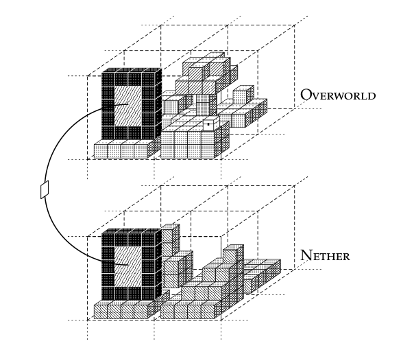

This post is a continuation of my earlier post
[Sheaves in Minecraft](/posts/sheaves_in_minecraft/), where I used Minecraft
to build intuition for sheaves. This time we go one step further and look at
topoi in Minecraft.

{fig-alt="Overworld and Nether drawn as block worlds, connected through a Nether portal"}

<iframe
  src="/mathcraft"
  style="width:100%; height:600px; border:none;"
  title="Mathcraft: Topoi in Minecraft (PDF)"
  height="600"
></iframe>

[Mathcraft.pdf](/mathcraft)
