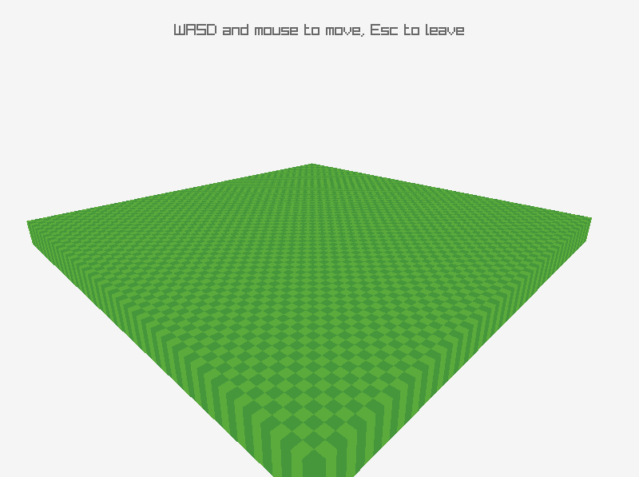
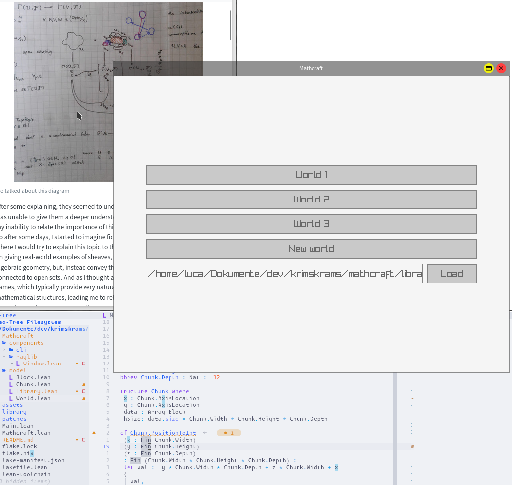

:::{.callout-note}
This post is a part of my ongoing series about sheaves in minecraft.
You can find more related posts [here](/blog.html#category=sheaves)
:::

:::{.callout-warning}
This post (and more specifically the PDF) are still a work in progress!
There may be _grave_ errors hidden in these texts!!! WATCH OUT!
:::

This post is a continuation of my earlier post
[Sheaves in Minecraft](/posts/sheaves_in_minecraft/), where I used Minecraft
to build intuition for sheaves. This time we go one step further and look at
topoi in Minecraft.

<iframe
  src="/mathcraft"
  style="width:100%; height:600px; border:none;"
  title="Mathcraft: Topoi in Minecraft (PDF)"
  height="600"
></iframe>

[Mathcraft.pdf](/mathcraft)

## History

This entire project has been long overdue. As mentioned before, I started it
around 2021 during my algebraic geometry classes at HHU. Still, I needed
_years_ to finally get a grip on the concepts.

One thing that gave me some trouble was that the restriction maps in the
original post were in fact wrong. In the original post I wrote something along
the lines of: we associate a set $\{\text{enemy}_1, \text{enemy}_2, \dots\}$ to
each open set (a union of chunks). But how do we define the restriction maps if,
for example, there are two chunks $U_1$, $U_2$, one of which contains, say, a
skeleton $F(U_1) = \{s\}$ while the other one does not, $F(U_2) = \emptyset$?
We may want to restrict from the union $U = U_1 \cup U_2$ to $U_2$, but there
is no function $r \colon F(U) \to F(U_2)$! I mean, where would the skeleton be
mapped to lol???

I kinda knew back then that this was wrong, but I simply assumed that $r$ would
only be a partial function. Looking back, that is the wrong approach. Instead,
we wish to consider functions and not just sets, so
$F(U) = \operatorname{Hom}(U, \texttt{List[Entity]})$, and we may choose a
section $f \in F(U)$ with

$$
f(p) = \begin{cases}
  [s] & \text{if } p \text{ is the position of the skeleton},\\
  [\,] & \text{else.}
\end{cases}
$$

Like this, we can also restrict correctly via $r(g) = g|_{U_i}$.

## Implementation in Lean4

I have been working on a Lean4 implementation of the ideas in this post from
time to time. I currently use raylib for drawing, but it is still a huge work
in progress. Not all ideas of the paper are implemented yet.

::: {layout-ncol=2}
{.lightbox group="lean-impl"}

{.lightbox group="lean-impl"}
:::
