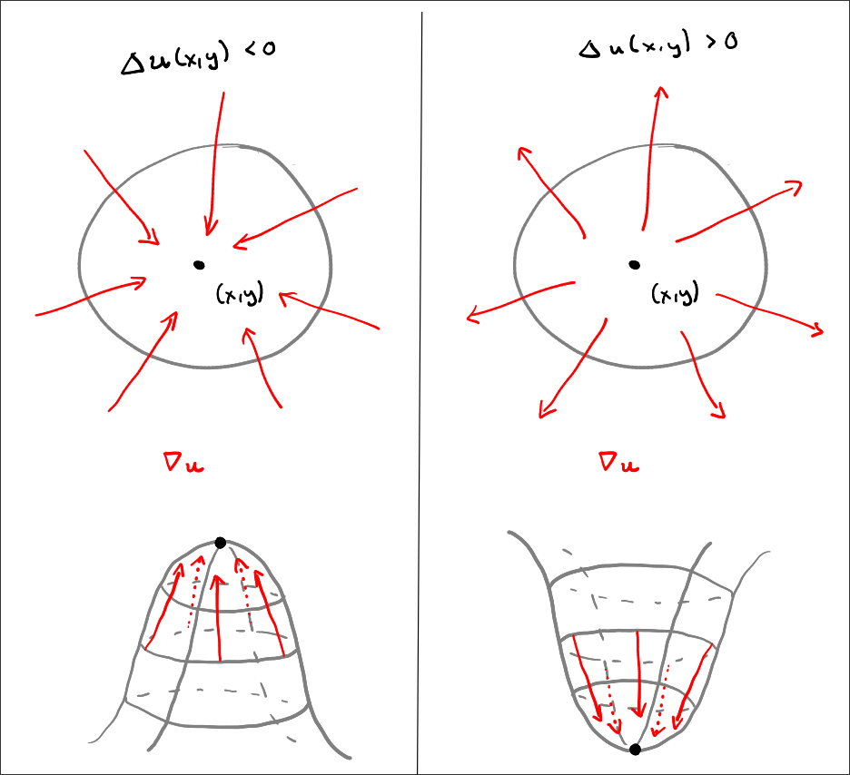

Elliptic differential equations are a class of partial differential equations (PDEs) that arise in various fields of __science__ and __engineering__.

Typically, they are used to model phenomena such as:

- Steady-state heat distribution
- Electrostatic potential
- Gravitational potential
- Fluid flow
- Elasticity
- ...
  


Assume you are given an [elliptic differential equaiton](https://en.wikipedia.org/wiki/Elliptic_partial_differential_equation)
possibly of the form:

$$
\begin{cases}
- \Delta u(x,y) &= f(x,y) & \forall (x,y) \in \Omega \\
u(x,y) &= g(x,y) & \forall (x,y)/ \in \partial \Omega
\end{cases}
$$

on the region $\Omega = (0,1)^2$. In this case, we would deal with a poisson
equation. And lets say, we wish to model gravity. In 3D, this would mean that
$\Delta u = 4 \pi \rho$, where $\rho$ is our mass density function. Because we
are dealing with 2D here, we will not use the area of a sphere, but instead
use the area of a disk, so we replace $4 \pi$ by $2 \pi$. The mass density would
assign each point in our space $\Omega$ the mass which is located there. An
example could be the one one I plotted here:

<iframe src="https://www.desmos.com/3d/dcevrb5isv" width="100%" style="min-height:300px"></iframe> 

This would represent two objects at points $(0,0)$ and $(1,1)$ of different
sizes and with different masses.
Or, similarily, we could imagine $\Omega$ hosting a point-cloud of
particles. $\rho$ would then represent the amount of particles in a small region
around a given point (i.e. their _mass_).

$$\Delta u(x,y) = \left(\frac{ \partial^2 }{ \partial x^2 }u(x,y)\right)^2 + \left(\frac{ \partial^2 }{ \partial y^2 }u(x,y)\right)^2$$

or equivalently:

$$
\Delta u(x,y) = \nabla \cdot \nabla u(x,y)
$$

where $\nabla u(x,y)$ is the gradient vector field, associating to each point
in $\Omega$ the vector of steepest ascent and $\nabla \cdot$ takes in a vector
field and measures for each point how much, for a small region the vectors flow
out of it (the divergence). Together, this means that $\Delta u$ measures the
net outflow of the gradient field for each point:

- Positive Laplacian: Means the "uphill" vectors are generally pointing out 
  from the point (like an upside-down cone, a minimum).
- Negative Laplacian: Means the "uphill" vectors are generally pointing in 
  toward the point (like a normal hill, a maximum).


So $- \Delta u(x,y) = f(x,y) \forall (x,y) \in \Omega$ means the higher $f(x,y)$ is,
the more negative $-\Delta u(x)$ is, and therefor more points near $(x,y)$ are
attracted to it. This is exactly what we would expect from gravitational force!
We may see this more clearly, be pushing the signs around: 
$\Delta u(x,y) = - f(x,y) \forall (x,y) \in \Omega$

It might be a good idea to also visualize our mirrored $f$:

<iframe src="https://www.desmos.com/3d/3jewa9gusw" width="100%" style="min-height:300px"></iframe> 

And this might look familiar to an experiment intended to explain gravity, which
I assume most have already seen:

<iframe width="560" height="315" src="https://www.youtube.com/embed/MTY1Kje0yLg?si=GYK5YN2Hgvft0cyZ" title="YouTube video player" frameborder="0" allow="accelerometer; autoplay; clipboard-write; encrypted-media; gyroscope; picture-in-picture; web-share" referrerpolicy="strict-origin-when-cross-origin" allowfullscreen></iframe>



The influx in the above picture is represented by the laplacian $\Delta u$.
The gray space around the point $(x,y)$ would then be the other values which $u$
takes on in a neighborhood around $(x,y)$.

---

How can we find $u$ given the above poisson equation?

We will calculate the solution approximately on a grid

```{python}
#| code-fold: true
import numpy as np
import plotly.graph_objects as go

N = 10
h = 1 / (N + 1)

square = ([0, 1, 1, 0, 0], [0, 0, 1, 1, 0], [0]*5)

grid_x = [i*h for i in range(1, N+1) for j in range(1, N+1)]
grid_y = [j*h for i in range(1, N+1) for j in range(1, N+1)]
grid_z = [0] * len(grid_x)

boundary = [(x,y,z) 
  for (x,i) in [ (i*h,i) for i in range(N+2) ] 
  for (y,j) in [ (i*h,i) for i in range(N+2) ] 
  for z in [0]
  if i == 0 or j == 0 or i == N+1 or j == N+1
]

fig = go.Figure()

fig.add_trace(go.Scatter3d(x=square[0], y=square[1], z=square[2], mode='lines',
                           line=dict(color='black', width=4), name='Unit Square'))
fig.add_trace(go.Scatter3d(x=grid_x, y=grid_y, z=grid_z, mode='markers',
                           marker=dict(size=5, color='blue'), name=f'Interior (N={N})'))
fig.add_trace(go.Scatter3d(
  x=[v[0] for v in boundary],
  y=[v[1] for v in boundary],
  z=[v[2] for v in boundary],
  mode='markers',
  marker=dict(size=5, color='red'),
  name='Boundary'))

fig.update_layout(
    title=f'Unit Square in (x,y) Plane with Grid Points (N={N}, h={h:.4f})',
    scene=dict(xaxis_title='X', yaxis_title='Y', zaxis_title='Z', aspectmode='cube'),
    showlegend=True, width=800, height=800
)

fig.show()
```

## Finite differences — from scratch

The standard approach for numerically solving the Poisson equation on a
uniform grid is the **finite difference method**.  We replace the Laplacian
with its five-point stencil:

$$
-\Delta u(x_i, y_j) \approx \frac{4u_{i,j} - u_{i-1,j} - u_{i+1,j} - u_{i,j-1} - u_{i,j+1}}{h^2}
= f(x_i, y_j)
$$

where $h = \tfrac{1}{N+1}$ is the grid spacing and $(x_i, y_j) = (ih, jh)$
for $i,j \in \{1,\ldots,N\}$ are the interior nodes.  Stacking all $N^2$
equations in row-major order gives a linear system $A\mathbf{u} = \mathbf{b}$.

The following implementation builds that system in a purely functional
style (no mutable loops, only `map`, list comprehensions, and `reduce`).

```{python}
#| code-fold: true
import numpy as np
import plotly.graph_objects as go
from functools import reduce

N = 30
h = 1 / (N + 1)

def f(x, y):
    rho1 = 3.0 * np.exp(-60 * ((x - 0.25)**2 + (y - 0.25)**2))
    rho2 = 1.5 * np.exp(-60 * ((x - 0.70)**2 + (y - 0.65)**2))
    return 2 * np.pi * (rho1 + rho2)

xs = list(map(lambda i: (i + 1) * h, range(N)))
ys = list(map(lambda j: (j + 1) * h, range(N)))

def idx(i, j): return i * N + j

def stencil_entries(N, h):
    diag  = [(idx(i,j), idx(i,j),    4/h**2) for i in range(N) for j in range(N)]
    left  = [(idx(i,j), idx(i,j-1), -1/h**2) for i in range(N) for j in range(1, N)]
    right = [(idx(i,j), idx(i,j+1), -1/h**2) for i in range(N) for j in range(0, N-1)]
    up    = [(idx(i,j), idx(i-1,j), -1/h**2) for i in range(1, N) for j in range(N)]
    down  = [(idx(i,j), idx(i+1,j), -1/h**2) for i in range(0, N-1) for j in range(N)]
    return diag + left + right + up + down

def add_entry(A, entry):
    r, c, v = entry
    A[r, c] += v
    return A

A = reduce(add_entry,
           stencil_entries(N, h),
           np.zeros((N * N, N * N)))

b = np.array([f(xs[i], ys[j]) for i in range(N) for j in range(N)])

U = np.linalg.solve(A, b).reshape(N, N)

X, Y = np.meshgrid(xs, ys)
fig = go.Figure(data=[
    go.Surface(x=X, y=Y, z=U.T, colorscale='Viridis',
               contours=dict(z=dict(show=True, usecolormap=True, highlightcolor="limegreen")))
])
fig.update_layout(
    title='Solution u(x,y) of −Δu = f  [from scratch, N=30]',
    scene=dict(xaxis_title='x', yaxis_title='y', zaxis_title='u(x,y)'),
    width=750, height=600,
)
fig.show()
```

---

## Using a library: `scipy.sparse`

Building a dense $N^2 \times N^2$ matrix becomes prohibitively expensive for
large $N$.  The stiffness matrix $A$ is actually very sparse — each row has at
most five non-zero entries.

A slicker way to construct the 2-D Laplacian is via the **Kronecker sum**:

$$
A = T \otimes I_N + I_N \otimes T, \qquad T = \frac{1}{h^2}\operatorname{tridiag}(-1,\,2,\,-1)
$$

`scipy.sparse` provides both `kron` and a direct sparse solver, which makes
this the preferred approach in practice.

```{python}
#| code-fold: true
import numpy as np
import scipy.sparse as sp
import scipy.sparse.linalg as spla
import plotly.graph_objects as go

N = 80
h = 1 / (N + 1)

def f(x, y):
    rho1 = 3.0 * np.exp(-60 * ((x - 0.25)**2 + (y - 0.25)**2))
    rho2 = 1.5 * np.exp(-60 * ((x - 0.70)**2 + (y - 0.65)**2))
    return 2 * np.pi * (rho1 + rho2)

e  = np.ones(N)
T1 = sp.spdiags([-e, 2*e, -e], [-1, 0, 1], N, N, format='csr') / h**2

I  = sp.eye(N, format='csr')
A  = sp.kron(T1, I) + sp.kron(I, T1)

xs = np.array([(i + 1) * h for i in range(N)])
ys = np.array([(j + 1) * h for j in range(N)])
b  = np.array([f(xs[i], ys[j]) for i in range(N) for j in range(N)])

U  = spla.spsolve(A.tocsr(), b).reshape(N, N)

X, Y = np.meshgrid(xs, ys)
fig = go.Figure(data=[
    go.Surface(x=X, y=Y, z=U.T, colorscale='Viridis',
               contours=dict(z=dict(show=True, usecolormap=True, highlightcolor="limegreen")))
])
fig.update_layout(
    title='Solution u(x,y) of −Δu = f  [scipy.sparse, N=80]',
    scene=dict(xaxis_title='x', yaxis_title='y', zaxis_title='u(x,y)'),
    width=750, height=600,
)
fig.show()
```

::: {.callout-note}
Both approaches produce the same solution — the gravitational potential $u$
induced by two mass concentrations located at $(0.25, 0.25)$ and
$(0.70, 0.65)$.  The sparse solver handles $N = 80$ (6 400 unknowns) effortlessly,
while the dense solver would require storing a $6400 \times 6400$ matrix.
For even larger systems one would switch to an iterative solver such as
**conjugate gradients** (`spla.cg`) combined with an AMG or ILU preconditioner.
:::

---

## Applied FEM: The Cow

In industry, the finite element method is routinely used to identify **stress
concentrations** and **structural failure zones** before a part is manufactured.

Classically you'd analyze the stress distribution on a simple geometry like:

:::{layout-ncol="2"}
{group="fem-example"}

{group="fem-example"}

{group="fem-example"}

:::

We wish to stay closer to acutal, real life applications though. Everyone knows has done this before: you take a cow and you compress it by applying a load on it (in engineering, this is called a "cowpression", like "cow" and "compression").

For this classic example in engineering (analogous to the aerodynamic analysis of a cow), we will put a cow under a press and compute where inside the cow the stress concentrates.



```{python}
#| code-fold: true
import numpy as np
import plotly.graph_objects as go
import trimesh
mesh = trimesh.load_mesh('../../assets/lowpolycow/cow.obj')
mesh.apply_transform(trimesh.transformations.rotation_matrix(np.radians(90), [1, 0, 0]))
mesh.apply_transform(trimesh.transformations.rotation_matrix(np.radians(90), [0, 0, -1]))
# visualize the cow mesh
fig = go.Figure(data=[
    go.Mesh3d(
        x=mesh.vertices[:, 0],
        y=mesh.vertices[:, 1],
        z=mesh.vertices[:, 2],
        i=mesh.faces[:, 0],
        j=mesh.faces[:, 1],
        k=mesh.faces[:, 2],
        color='lightblue',
        opacity=0.5,
        name='Cow Mesh'
    )
])
fig.update_layout(
    title='Low-Poly Cow Mesh',
    scene=dict(xaxis_title='X', yaxis_title='Y', zaxis_title='Z'),
    width=800, height=600,
)
fig.show()
```

Like most 3D models made for rendering, our cow is not one solid, but a bunch of
separate, overlapping shells:

```{python}
#| code-fold: true
pieces = mesh.split(only_watertight=False)
fig = go.Figure(data=[
    go.Mesh3d(
        x=p.vertices[:, 0], y=p.vertices[:, 1], z=p.vertices[:, 2],
        i=p.faces[:, 0], j=p.faces[:, 1], k=p.faces[:, 2],
        color=f'hsl({int(360 * n / len(pieces))}, 70%, 55%)',
        name=f'piece {n}'
    )
    for n, p in enumerate(pieces)
])
fig.update_layout(
    title='The cow, coloured by mesh piece',
    scene=dict(xaxis_title='X', yaxis_title='Y', zaxis_title='Z', aspectmode='data'),
    width=800, height=600,
)
fig.show()
```

We combine these pieces into one solid by *remeshing*, in our case by
**voxelization**: we fill the cow with small cubes of side length $h$.

### Solving linear elasticity

The Poisson equation describes a *scalar* quantity like temperature or a
potential. To get stress, we need the *displacement* $u : \Omega \to \mathbb{R}^3$,
which says how far each point of the cow moves when we squeeze it. From $u$ we get
the strain $\varepsilon$ (how much the material is stretched) and, through Hooke's
law, the stress $\sigma$:

$$
\varepsilon(u) = \tfrac{1}{2}\left(\nabla u + \nabla u^\top\right),
\qquad
\sigma(u) = \lambda \operatorname{tr}(\varepsilon)\, I + 2 \mu\, \varepsilon .
$$

Force balance then gives the equations of **linear elasticity**:

$$
\begin{cases}
- \operatorname{div} \sigma(u) &= f & \text{in } \Omega \quad \text{(gravity)}\\
u &= 0 & \text{on the hooves} \quad \text{(standing on the floor)}\\
\sigma(u)\, n &= t & \text{on the back} \quad \text{(the press)}
\end{cases}
$$

As this is elliptic again, we can follow the same process as before.
At the end we condense the stress tensor into the
[von Mises stress](https://en.wikipedia.org/wiki/Von_Mises_yield_criterion) scalar.
We can use this and compare its value to thesholds which are empirically
collected for each material our object is build out of. If the threshold is
surpassed in a region, then that region will likely break.
We assume the cow to be 2.4m with the density of water and a force of $5\,\text{kN}$
pushes down on it (around 500kg).

```{python}
#| code-fold: true
import scipy.sparse as sp
import scipy.sparse.linalg as spla

# --- Voxelize: one solid cow, 2.4 m long ---
cow = mesh.copy()
cow.apply_scale(2.4 / np.ptp(cow.vertices[:, 0]))
h = 0.07                                   # voxel size in metres
vox = cow.voxelized(h).fill()
occ = vox.matrix                           # occ[i,j,k] = True if voxel is cow
origin = vox.transform[:3, 3] - h / 2      # corner of voxel (0,0,0)
els = np.argwhere(occ)                     # one hexahedral element per voxel

# --- Material: Hooke's law as a 6x6 matrix (Voigt notation) ---
E, nu = 1e7, 0.3                           # E doesn't change the stresses
lam, mu = E * nu / ((1 + nu) * (1 - 2 * nu)), E / (2 * (1 + nu))
D = np.zeros((6, 6)); D[:3, :3] = lam
D += np.diag([2 * mu] * 3 + [mu] * 3)

# --- Element stiffness of one voxel (2x2x2 Gauss quadrature) ---
corners = np.array([[0,0,0],[1,0,0],[1,1,0],[0,1,0],[0,0,1],[1,0,1],[1,1,1],[0,1,1]])
s = 2 * corners - 1

def strain_matrix(xi):
    """B maps the 24 corner displacements to the 6 strain components at xi."""
    dN = np.empty((8, 3))
    for a in range(3):
        b, c = [d for d in range(3) if d != a]
        dN[:, a] = s[:, a] / 8 * (1 + s[:, b] * xi[b]) * (1 + s[:, c] * xi[c]) * 2 / h
    B = np.zeros((6, 24))
    for n, (dx, dy, dz) in enumerate(dN):
        B[:, 3*n:3*n+3] = [[dx,0,0],[0,dy,0],[0,0,dz],[dy,dx,0],[0,dz,dy],[dz,0,dx]]
    return B

g = 1 / np.sqrt(3)
Ke = sum(strain_matrix(xi).T @ D @ strain_matrix(xi) * (h / 2)**3
         for xi in np.array(np.meshgrid([-g, g], [-g, g], [-g, g])).reshape(3, -1).T)

# --- Assemble the global stiffness matrix ---
nshape = np.array(occ.shape) + 1
node_id = lambda ijk: np.ravel_multi_index(np.asarray(ijk).T, nshape)
used, conn = np.unique(np.stack([node_id(els + c) for c in corners], axis=1),
                       return_inverse=True)
conn = conn.reshape(-1, 8)                 # element -> its 8 nodes
nodes = np.array(np.unravel_index(used, nshape)).T * h + origin
dofs = (3 * conn[:, :, None] + np.arange(3)).reshape(-1, 24)
ndof = 3 * len(nodes)

K = sp.coo_matrix(
    (np.broadcast_to(Ke, (len(els), 24, 24)).ravel(),
     (np.repeat(dofs, 24, axis=1).ravel(), np.tile(dofs, (1, 24)).ravel())),
    shape=(ndof, ndof)).tocsr()

# --- Loads: gravity on every voxel + the press on the back ---
rho, grav, F_press = 1000.0, 9.81, 5000.0
F = np.zeros(ndof)
np.add.at(F, 3 * conn.ravel() + 2, -rho * grav * h**3 / 8)

top = els[~np.pad(occ, 1)[tuple((els + [1, 1, 2]).T)]]   # nothing above these
x_top, z_top = (top * h + origin)[:, [0, 2]].T
x0 = nodes[:, 0].min()
back = top[(x_top > x0 + 0.25) & (x_top < x0 + 1.2) & (z_top > 0.3)]
back_nodes = np.searchsorted(used, node_id((back[:, None] + corners[4:]).reshape(-1, 3)))
np.add.at(F, 3 * back_nodes + 2, -F_press / len(back_nodes))

# --- Boundary condition: the lowest layer of each hoof is glued to the floor ---
z0 = nodes[:, 2].min()
hoof = np.where(nodes[:, 2] < z0 + 1.5 * h)[0]
fixed = (3 * hoof[:, None] + np.arange(3)).ravel()
free = np.setdiff1d(np.arange(ndof), fixed)

u = np.zeros(ndof)
u[free] = spla.spsolve(K[free][:, free].tocsc(), F[free])

# --- Von Mises stress in the centre of every voxel ---
sig = (D @ strain_matrix(np.zeros(3)) @ u[dofs].T).T
vm = np.sqrt(0.5 * ((sig[:, 0] - sig[:, 1])**2 + (sig[:, 1] - sig[:, 2])**2
                    + (sig[:, 2] - sig[:, 0])**2) + 3 * (sig[:, 3:]**2).sum(1)) / 1e3

R = (K @ u - F)[3 * hoof + 2]               # vertical force on the floor
front = nodes[hoof, 0] > nodes[hoof, 0].mean()
centres = els * h + origin + h / 2
legs = centres[:, 2] < z0 + 0.6
print(f"{len(els)} voxels, {ndof} unknowns")
print(f"cow mass: {occ.sum() * h**3 * rho:.0f} kg")
print(f"front legs carry {R[front].sum() / R.sum():.0%} of the load")
print(f"median von Mises stress: legs {np.median(vm[legs]):.1f} kPa, "
      f"rest of the cow {np.median(vm[~legs]):.1f} kPa")

# --- Plot: every outer voxel face, coloured by the stress of its voxel ---
face_corners = {
    (1,0,0): [(1,0,0),(1,1,0),(1,1,1),(1,0,1)], (-1,0,0): [(0,0,0),(0,0,1),(0,1,1),(0,1,0)],
    (0,1,0): [(0,1,0),(0,1,1),(1,1,1),(1,1,0)], (0,-1,0): [(0,0,0),(1,0,0),(1,0,1),(0,0,1)],
    (0,0,1): [(0,0,1),(1,0,1),(1,1,1),(0,1,1)], (0,0,-1): [(0,0,0),(0,1,0),(1,1,0),(1,0,0)],
}
pad = np.pad(occ, 1)
quads, stress = [], []
for d, cs in face_corners.items():
    outside = ~pad[tuple((els + 1 + np.array(d)).T)]
    quads.append((els[outside][:, None] + np.array(cs)) * h + origin)
    stress.append(vm[outside])
quads, stress = np.concatenate(quads).reshape(-1, 3), np.concatenate(stress)
q = 4 * np.arange(len(stress))

fig = go.Figure(data=[go.Mesh3d(
    x=quads[:, 0], y=quads[:, 1], z=quads[:, 2],
    i=np.r_[q, q], j=np.r_[q + 1, q + 2], k=np.r_[q + 2, q + 3],
    intensity=np.r_[stress, stress], intensitymode='cell',
    colorscale='Inferno', cmin=0, cmax=np.percentile(vm, 99),
    colorbar=dict(title='von Mises<br>stress [kPa]'),
    flatshading=True, name='cow'
)])
fig.update_layout(
    title='Linear elasticity FEM – stress in a cow under a press',
    scene=dict(xaxis_title='X [m]', yaxis_title='Y [m]', zaxis_title='Z [m]',
               aspectmode='data'),
    width=800, height=600,
)
fig.show()
```
Color indicates the stress. For the hooves, due to sharp corners, we discard
their stress values, which would otherwise be unreasonably high.

### What this means for the cow

As we can see, our cow with its disproportionally large head creates high stress
specifically for its front legs. We would now have to check with the cows
empirically collected stress tolerances in these danger regions, if the cow will
break.
