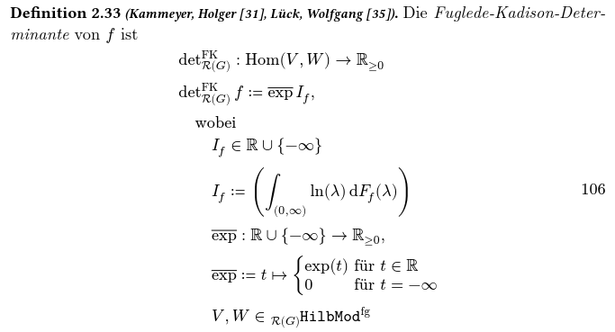

I have long been fascinated by topos theory. Initially, and I can still clearly
remember this, I watched some videos by
[Richard Southwell](https://www.youtube.com/@RichardSouthwell) on YouTube.
It started out with videos about synthetic differential geometry, which I wanted
to use since I was quite fascinated by tangent spaces and geodesics.
I assume most game developers are, once they have successfully transitioned from
2d game dev to 3d, and in my case even beyond!
My progression was that I started with 2d games like
[Jump 'n runner](/posts/qcoded/), then went to 3d games like
[WebGLCS](/posts/webglcs/) and finally went to 4d games like
[dimensioncrusher](https://github.com/Quoteme/dimensioncrusher).

::: {layout-ncol=3}
](/posts/qcoded/thumbnail.gif){.lightbox group="dimensions"}

](./assets/webglcs.png){.lightbox group="dimensions"}

](./assets/dimensioncrusher.gif){.lightbox group="dimensions"}
:::

Richard Southwell started this video series about synthetic differential
geometry back then:

<iframe src="https://www.youtube.com/embed/1NJvNZ9Lig8?controls=1&rel=0" title="Richard Southwell: Synthetic Differential Geometry" frameborder="0" allow="accelerometer; autoplay; clipboard-write; encrypted-media; gyroscope; picture-in-picture; web-share" referrerpolicy="strict-origin-when-cross-origin" allowfullscreen></iframe>

In it, he mentioned that this would rely on topos theory, which he has also done
videos about:

<iframe src="https://www.youtube.com/embed/o-yBDYgUqZQ?controls=1&rel=0&start=2601" title="Richard Southwell: Topos Theory" frameborder="0" allow="accelerometer; autoplay; clipboard-write; encrypted-media; gyroscope; picture-in-picture; web-share" referrerpolicy="strict-origin-when-cross-origin" allowfullscreen></iframe>

This also prompted me to ask Prof. Dr. Schröer at the end of Algebraic
Geometry I if we could do some topos theory, which he however declined, as he
deemed this topic too complex to teach in an algebraic geometry lecture course.
This sparked my interest even further, and naturally, after I learned that
Prof. Dr. Arndt at HHU published some work on interpretations of dependent
product ($\Pi$) and dependent sum ($\Sigma$) types using model categories, which
was something that I needed for my masters thesis, I was hooked, since he is
also especially knowledgeable in topos theory.

## Dependent typing in category theory

My biggest grief in category theory so far was that it lacked the proper
notation for "dependent typing".
Consider the Fuglede-Kadison determinant, which I used in my masters thesis:

{.lightbox}

In it, I needed to write
$$
\det^{\mathrm{FK}}_{\mathcal{R}(G)} : \mathrm{Hom}(V, W) \to \mathbb{R}_{\geq 0}
$$
for $V, W$ some finitely generated $\mathcal{R}(G)$-modules.
Instead, we would rather write this as a dependent function
$$
\det^{\mathrm{FK}}_{\mathcal{R}(G)} : \prod_{V, W \,:\, {}_{\mathcal{R}(G)}\mathtt{HilbMod}^{\mathrm{fg}}} \big(\mathrm{Hom}(V, W) \to \mathbb{R}_{\geq 0}\big),
$$
so that we do not explicitly need to fix $V$ and $W$.
I still have not solved this problem, but I am still working on it (I heard for
example that
[categories with families](https://ncatlab.org/nlab/show/categories+with+families)
might be one possible approach to that?).

## The topos of trees

Well, this led me to research the topic of the topos of trees, as that seemed
like an especially easy topic to get started with topos theory and to apply its
internal intuitionistic logic.

You can read my second bachelor thesis here:

<iframe
  src="../../bachelor2/ba.pdf"
  style="width:100%; height:600px; border:none;"
  title="Second bachelor thesis: The Topos of Trees (PDF)"
  height="600"
></iframe>

[The Topos of Trees (PDF)](https://quoteme.github.io/bachelor2)

If you are wondering what I did in my first bachelor thesis about algebraic
geometry and cryptography, you can read about it [here](/posts/bachelorarbeit/).
And my masters thesis on $\ell^2$-invariants is [here](/posts/masterarbeit/).
